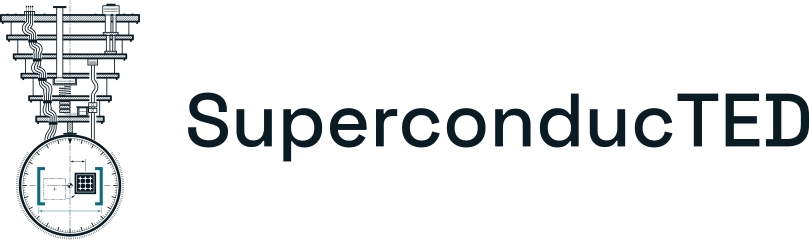

  <picture>
    <source media="(prefers-color-scheme: dark)" srcset="brand/svg/superconducted-horizontal-on-dark.svg">
    
  </picture>

# SuperconducTED/.github

The organisation's home repository on GitHub. SuperconducTED is student research at TED
University in Ankara on honest noise models for superconducting quantum computers: a noise
engine for Qiskit Aer that answers a drifting machine with a range, not a single number.

| Path | What it holds |
| --- | --- |
| [`profile/README.md`](profile/README.md) | The page GitHub shows at [github.com/SuperconducTED](https://github.com/SuperconducTED) |
| [`header.svg`](header.svg), [`fuzzy-noise.svg`](fuzzy-noise.svg), [`it2.svg`](it2.svg) | Images from the profile's earlier long form (a copy of `brand/web/profile-header.svg` and two explainer diagrams). Since 2026-10-16 the profile loads only the stacked lockup from `brand/svg/`, so nothing on the page uses them |
| [`brand/`](brand/README.md) | The SuperconducTED identity: the cutaway mark and the mathematics behind it, lockups, the Cryostat palette, typography, the chart style, every file format, and the scripts that build and check them |
| [`CODE_OF_CONDUCT.md`](CODE_OF_CONDUCT.md) | The organisation's code of conduct: the Contributor Covenant 2.1 |
| [`CONTRIBUTING.md`](CONTRIBUTING.md) | The organisation's general contributing guide, with the rules for this repository at the end |
| [`SECURITY.md`](SECURITY.md) | How to report a security problem privately, and what to expect |
| [`SUPPORT.md`](SUPPORT.md) | Where to ask questions, and what to include |
| [`.github/ISSUE_TEMPLATE/`](.github/ISSUE_TEMPLATE/) | Default issue forms (bug report, feature or improvement, question) and the template chooser's `config.yml` |
| [`.github/pull_request_template.md`](.github/pull_request_template.md) | The default pull request template |
| [`docs/implementations/`](docs/implementations/) | One document per change: what was done, why, and how it was verified |
| [`LICENSE`](LICENSE), [`NOTICE`](NOTICE) | The licence, and which part of the repository is under which licence |

## The organisation's repositories

| Repository | What it is |
| --- | --- |
| [superconducted-noise-engine](https://github.com/SuperconducTED/superconducted-noise-engine) | The flagship: a fuzzy-logic noise engine for Qiskit Aer that turns IBM calibration snapshots into an ensemble of noise models, aiming for interval predictions across calibration cycles. Research preview. |
| [superconducted.github.io](https://github.com/SuperconducTED/superconducted.github.io) | The website, <https://superconducted.github.io/>, in English and Turkish |
| superconducted-codesign | The requirements and design record of the co-design tool (private for now) |
| `.github` | This repository |

## How the organisation defaults work

The code of conduct, contributing guide, security policy, support guide and templates here are
organisation defaults: GitHub uses each one for every repository in the organisation that has no
file of that type of its own, and a repository's own file always takes precedence. Issue forms
are all or nothing: a repository with its own templates or `config.yml` in
`.github/ISSUE_TEMPLATE` uses none of the defaults.

`profile/README.md` is shown publicly because this repository is public. A members-only profile
would go in a separate repository named `.github-private`.

## The brand in one minute

- **Mark:** the technical cutaway, an engineering drawing of a dilution refrigerator whose chip
  has drifted off its calibrated datum, with the range dimensioned around it. Its mathematics is
  in [`brand/CONSTRUCTION.md`](brand/CONSTRUCTION.md).
- **Colours:** Cryostat, `#0A1B24`, `#EEF3F5` and the accent `#0A6C7C` (light grounds) or
  `#4FD6E6` (dark grounds). The accent means the range and nothing else.
- **Type:** Space Grotesk and Space Mono.
- **Tagline:** "Noise as a range, not a number."
- **Files:** [`brand/svg/`](brand/svg/), [`png/`](brand/png/), [`pdf/`](brand/pdf/),
  [`eps/`](brand/eps/), [`web/`](brand/web/), [`source/`](brand/source/) and
  [`guide/`](brand/guide/). Start with the [brand guide](brand/README.md).

## Licence

This repository is licensed in two parts (see [`NOTICE`](NOTICE)):

- **MIT License** ([`LICENSE`](LICENSE)): the documentation, profile, community files, templates
  and the scripts in `brand/`.
- **CC BY 4.0** ([`brand/LICENSE-BRAND.md`](brand/LICENSE-BRAND.md)): the brand files (marks,
  lockups, cards, icons, chart styles and their sources). They may be shared and adapted, with
  credit.

The code of conduct is the Contributor Covenant (CC BY 4.0). Neither licence grants trademark
rights; [`brand/LICENSE-BRAND.md`](brand/LICENSE-BRAND.md) sets out what using the name and marks
does not imply.
