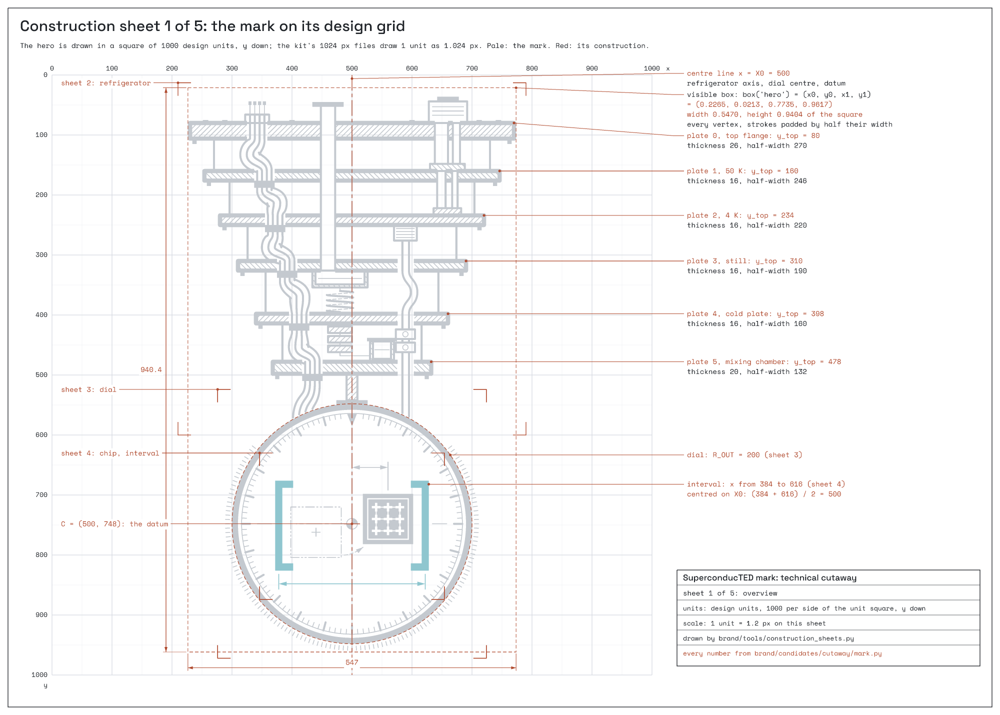
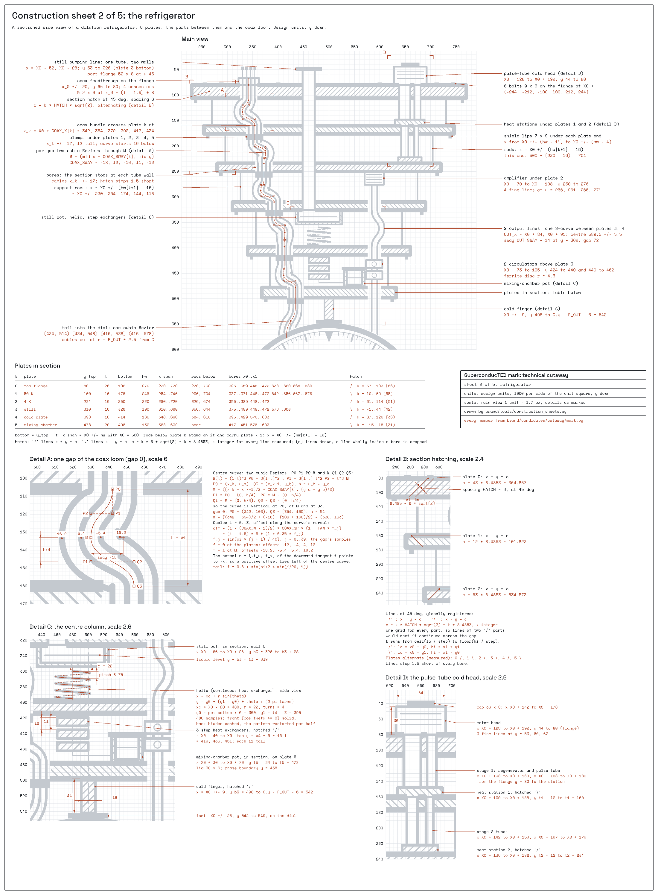
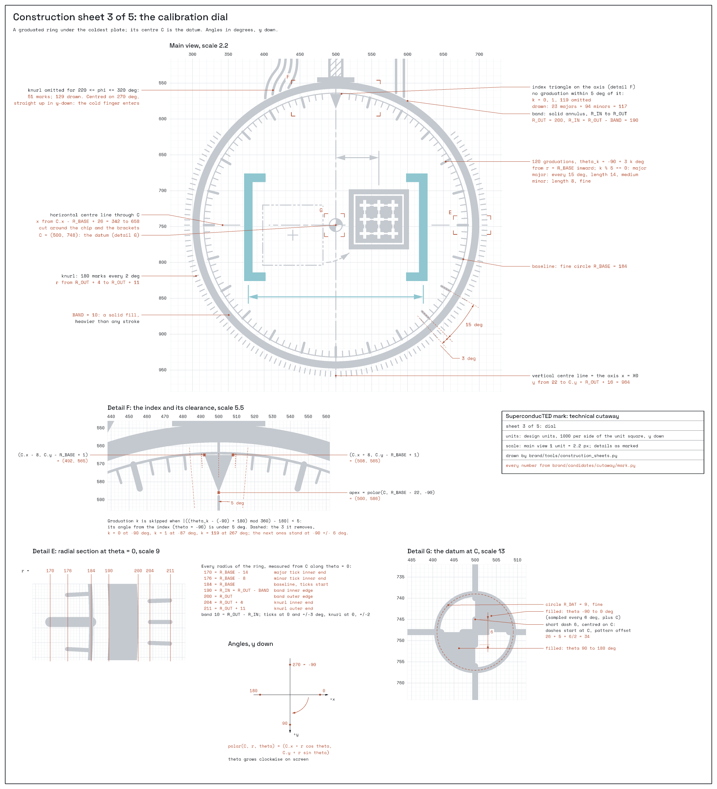
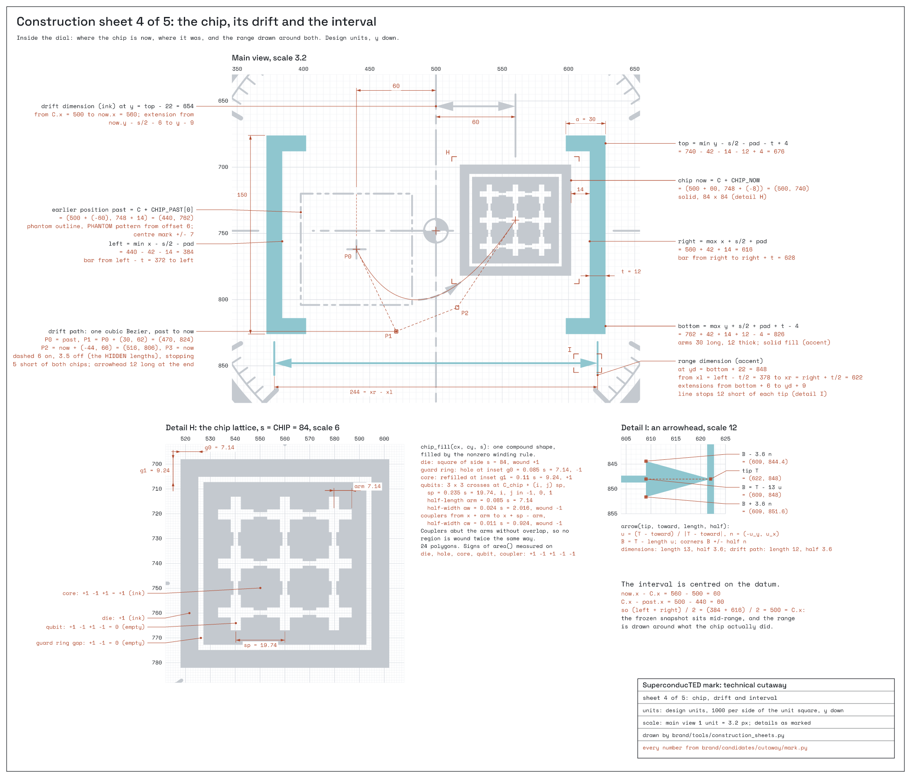
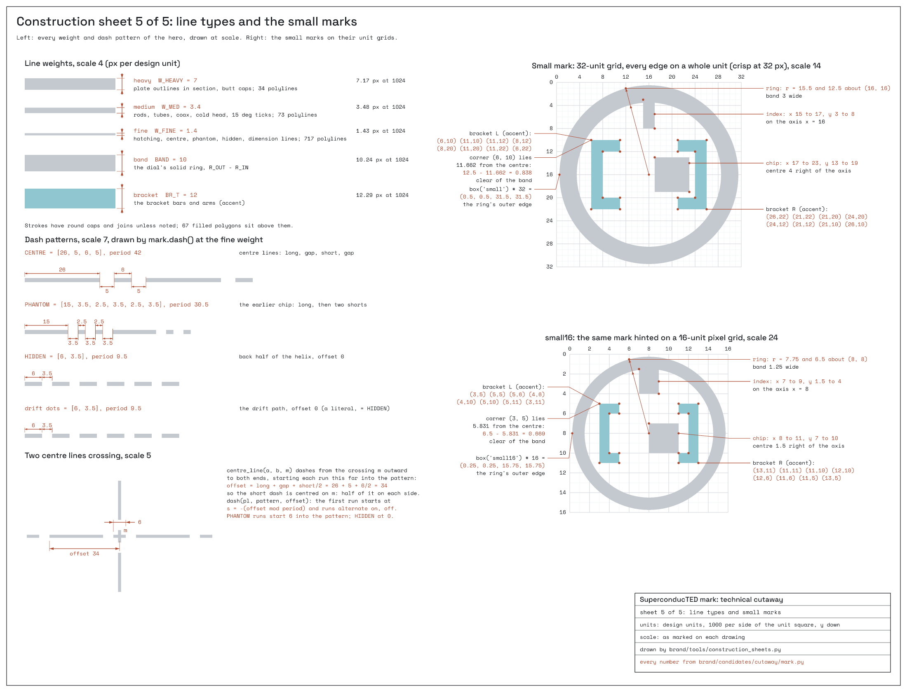

# The mathematics of the SuperconducTED mark

The SuperconducTED mark is not a picture someone drew by eye, and no part of it was generated by
an image model. It is an engineering drawing computed from the geometry in
[`candidates/cutaway/mark.py`](candidates/cutaway/mark.py): every plate, cable, tick, dash
and bracket comes from a number or a formula in that file, and VectorCraft only paints what the
formulas produce. This document explains those formulas so that anyone can check, reproduce or
extend the mark. The construction sheets in [`kit/guide/`](kit/guide/) draw the same numbers.

Every value below was computed from `mark.py` (no figure is typed in by hand from memory); the
section "Checking this document" shows how to recompute them.



## 1. Space, units and scale

- **Design space.** The hero mark lives in a square of **1000 by 1000 design units**, with the
  origin at the top left and **y pointing down** (the convention of SVG and of VectorCraft). The
  small marks live in squares of 32 and 16 units.
- **Scale.** Drawing the mark at size S (in points or pixels) maps a design point (x, y) to
  (o_x + s·x, o_y + s·y) with **s = S / 1000**. The kit's 1024 px files use s = 1.024.
- **Angles** are measured from the positive x axis and, because y points down, increase
  **clockwise** on screen: 0° points right, 90° points down, −90° (or 270°) points up.
- **Visible box.** The art does not fill its square. Its bounding box is measured on the
  emitted geometry itself: the minimum and maximum over every vertex, where a stroked line is
  padded by half its stroke width (the reach of a round cap). For the hero this gives
  **x from 0.2265 to 0.7735 and y from 0.0213 to 0.9617** of the square: the visible art is
  **0.547 wide and 0.9404 tall**. Layouts align the visible art, not the square.

## 2. Lines: weights, caps and types

The drawing uses the line conventions of mechanical drafting. Three stroke weights, plus two
solid widths that sit above every stroke:

| Weight | Design units | At 1024 px | Draws |
| --- | --- | --- | --- |
| Heavy | 7.0 | 7.2 px | Plate outlines in section (butt caps) |
| Medium | 3.4 | 3.5 px | Rods, tubes, cables, the cold head, major ticks |
| Fine | 1.4 | 1.4 px | Hatching, centre, phantom and hidden lines, dimension lines, minor ticks, the knurl |
| Solid band | 10 | 10.2 px | The dial's ring |
| Solid bar | 12 | 12.3 px | The interval brackets |

Line **types** are dash patterns laid along each line by **arc length**. For a polyline with
cumulative length s, a pattern (l₁, g₁, l₂, g₂, ...) of dash and gap lengths repeats with period
P = Σ lengths; the k-th dash covers the arc-length interval [s_k, s_k + l_k], and the pieces
of the polyline inside those intervals are kept.

| Type | Pattern (units) | Period | Meaning in drafting |
| --- | --- | --- | --- |
| Centre line | 26, 5, 6, 5 | 42 | An axis of symmetry |
| Phantom line | 15, 3.5, 2.5, 3.5, 2.5, 3.5 | 30.5 | Another position of a moving part |
| Hidden line | 6, 3.5 | 9.5 | An edge behind the visible surface |
| Drift dots | 6, 3.5 | 9.5 | The path the chip drifted along |

**Centring a centre line on a crossing.** A centre line should cross a point with its short
dash, not a gap. Each centre line is therefore drawn outwards from the crossing point m in both
directions with the pattern started at an offset of 26 + 5 + 6/2 = **34 units**: that offset
places the middle of the 6-unit short dash exactly on m. Both centre lines through the dial's
centre use this.

## 3. Section hatching

Where the drawing cuts through a part (the plates, the stations of the cold head, the pots, the
step exchangers, the cold finger), the cut face is hatched with 45° lines, as in any
engineering section.

- A hatch line is a member of the family **x + y = c** (drawn "/") or **x − y = c** (drawn "\"),
  with **c = k · h · √2** for integer k and perpendicular spacing **h = 6** units, so consecutive
  lines are 6 units apart and their intercepts are 6√2 ≈ 8.485 units apart along an axis.
- Because c is a multiple of a fixed step everywhere, the hatching is **globally registered**:
  the same grid of lines passes through every part, so neighbouring parts line up.
- Adjacent plates alternate direction: plates 0, 2 and 4 use "/", plates 1, 3 and 5 use "\",
  the drafting convention that separates touching parts in a section.
- Each hatch line is clipped to its part and cut where a tube or cable passes through (the
  bores below). Clipping a segment p + t(q − p), t in [0, 1], against a rectangle uses the
  Liang-Barsky method (four half-planes); against a circle it solves
  |p + t(q − p) − c|² = r² for t; against a convex polygon it intersects the half-planes of its
  edges. The pieces outside every bore are kept.

## 4. The refrigerator



Everything hangs on one vertical **centre line, x = X₀ = 500**.

### Plates

Six plates, from the room-temperature flange at the top to the mixing-chamber plate at the
bottom (their names only label the rows in the code; nothing names them in the drawing):

| Plate | Top y | Thickness | Bottom y | Half-width | x from, to | Gap above |
| --- | --- | --- | --- | --- | --- | --- |
| 0 (flange) | 80 | 26 | 106 | 270 | 230 to 770 | |
| 1 | 160 | 16 | 176 | 246 | 254 to 746 | 54 |
| 2 | 234 | 16 | 250 | 220 | 280 to 720 | 58 |
| 3 | 310 | 16 | 326 | 190 | 310 to 690 | 60 |
| 4 | 398 | 16 | 414 | 160 | 340 to 660 | 72 |
| 5 (mixing chamber) | 478 | 20 | 498 | 132 | 368 to 632 | 64 |

The half-widths narrow by 24, 26, 30, 30 and 28 units: the stack tapers toward the cold end, as
a real dilution refrigerator does. The plates were set by hand to read as one; no formula
generates the taper. Each plate is a heavy outline that **stops at the bores** where tubes or
cables pass through it, and its cut face is hatched (section 3). Small solid lips (7 by 9 units)
hang under each plate's ends, and six bolts (9 by 5) sit on the flange at x = 500 ± 100, ± 212
and ± 244.

### Support rods

Between plate k and plate k + 1, a pair of medium rods stands at **x = 500 ± (w_{k+1} − 16)**,
where w_{k+1} is the half-width of the lower plate: 16 units inside its ends. That gives
x = 270/730, 296/704, 326/674, 356/644 and **384/616**.

### The coax loom

Four cables run from a feedthrough on the flange down through every plate.

- **Bundle path.** Where it passes plate k, the bundle's centre is at x = 500 + d_k with
  d = (−158, −146, −128, −108, −88, −66): x = 342, 354, 372, 392, 412, 434, drifting toward
  the axis as the plates narrow.
- **The S-curve in each gap.** Between plate k (leaving at x_a, y_a) and plate k + 1 (arriving
  at x_b, y_t), the path is two cubic Bézier curves joined at a midpoint
  m = ((x_a + x_b)/2 + σ_k, (y_a + y_t)/2), with sways **σ = (−18, 12, −16, 11, −12)**
  alternating sides. Each curve leaves and arrives vertically: with gap height H = y_t − y_a,
  the first runs from (x_a, y_a) through control points (x_a, y_a + H/4) and (m_x, m_y − H/4)
  to m; the second mirrors it to (x_b, y_t). A cubic Bézier is
  **B(t) = (1 − t)³ P₀ + 3(1 − t)² t P₁ + 3(1 − t) t² P₂ + t³ P₃**, t in [0, 1], sampled at 21
  points per half. Below plates 1 to 5 the loom first passes a 16-unit clamp.
- **Four cables from one path.** Cable i (i = 0 to 3) is the bundle path offset along its
  normal by **(i − 1.5) · 8 · (1 + 0.35 · f_j)**. In each gap the curve has 40 sample points
  (j = 0 to 39) and **f_j = sin(π (j + 1) / 40)**; at the plates f = 0. So the cables are 8
  units apart where they pass a plate and fan out to 1.35 times that in mid-gap, as a real loom
  does when its clamps are far apart.
- The last stretch is one more Bézier from under the mixing-chamber plate to the dial: from
  (434, 514) through control points (434, 548) and (416, 538) to (416, 578), along which the fan opens
  as f = 0.6 · sin(π/2 · min(j/20, 1)). Every cable is clipped where it would cross the dial (a
  keep-out circle of radius R_out + 2.5).
- Attenuator clamps (34 by 12, solid) sit directly under plates 1 to 5; the hermetic
  feedthrough on the flange is 40 by 14 with four connectors.

### The helical heat exchanger

Under the still pot, a continuous heat exchanger coils around a vertical tube. The drawing is a
true orthographic side view of a **helix**:

- its centre line is x_c = 480, its radius r = 22, it rises over **4 turns** from y₀ = 360 to
  y₁ = 395 (pitch 8.75 units per turn);
- a point at angle θ (from 0 to 2π·4, sampled at 481 points) is drawn at
  **x = x_c + r sin θ, y = y₀ + (y₁ − y₀) · θ / (2π · 4)**;
- the helix's depth is z = r cos θ: where **cos θ ≥ 0** the coil is in front of its axis and is
  drawn solid (medium); where **cos θ < 0** it is behind, and is drawn as a **hidden line**
  (dashed 6, 3.5). That one sign test gives the coil its depth.

### The other parts

| Part | Geometry (design units) |
| --- | --- |
| Still pumping line | Two medium lines at x = 448 and 472, from y = 53 to the still plate's bottom (326), with a port block 52 by 8 above the flange |
| Pulse-tube cold head | A motor head from x = 628 to 692, y = 44 to 80, with three fine cooling fins; two tubes per stage; two hatched heat stations under plates 1 and 2 |
| Still pot (in section) | x = 434 to 526, y = 326 to 354, wall 5, a liquid-level line 13 below its top |
| Step heat exchangers | Three hatched blocks 40 by 11, x = 460 to 500, at y = 419, 435 and 451 |
| Mixing-chamber pot | x = 530 to 570, y = 444 to 478, wall 5, a lid, and a phase-boundary line 14 into the inner space |
| Output lines | Two lines 11 apart around x = 589.5, an amplifier box (38 by 26) under plate 2 and two circulators (32 by 16, each with a ferrite disc of radius 4.5) above plate 5; between the still and cold plates the pair sways 14 units in one S-curve |
| Cold finger | A hatched rod x = 491 to 509 from the mixing-chamber plate (y = 498) to just above the dial (y = 542), on a 52-unit flange |

## 5. The calibration dial



- **Centre:** C = (500, 748). This point is the **datum**: where the frozen calibration says
  the chip is.
- **Band:** a solid ring between **R_in = 190** and **R_out = 200** (10 units).
- **Graduations:** a fine baseline circle at **R_base = 184** carries 120 graduations, one every
  **3°**, starting at −90° (straight up). Every fifth graduation (every **15°**) is a major
  tick, 14 units long and medium; the others are minor ticks, 8 units long and fine. The
  graduations within 5° of straight up are left out to make room for the index, so **117** are
  drawn: 23 major and 94 minor.
- **Index:** a solid triangle pointing at the centre, with its tip at (500, 586) (R_base − 22
  above C) and its base from (492, 565) to (508, 565).
- **Knurled bezel:** 180 positions, one every **2°**, each a fine mark from R_out + 4 = 204 to
  R_out + 11 = 211. The marks from **220° to 320°** (the top of the dial in y-down angles) are
  left out where the cold finger enters, so **129** are drawn.
- **Datum symbol:** the drafting centre-of-mass symbol, a circle of radius 9 at C with the two
  opposite quadrants from −90° to 0° and from 90° to 180° filled.
- **Centre lines:** the refrigerator's axis continues down through C, and a horizontal centre
  line crosses it at C; both are phased so a short dash sits on C (section 2).

## 6. The chip, the drift and the interval



### The chip

The chip is a square die of side **s = 84**. Its interior is knocked out with nonzero-winding
polygons: the die is wound +1, a guard-ring slot from 0.085 s = 7.14 to 0.11 s = 9.24 inside
the edge is wound −1 (a hole), the core inside it is wound +1 again, and a **3 by 3 lattice of
cross-shaped qubits** is wound −1. The qubits sit at a pitch of 0.235 s = 19.74; each cross has
arms 0.085 s = 7.14 long and 0.024 s = 2.016 half-wide, and neighbouring qubits are joined by
couplers 0.011 s = 0.924 half-wide. The couplers meet the qubit arms without overlapping them,
so no region is wound twice the same way.

### Positions and drift

- The chip **now** sits at **C + (60, −8) = (560, 740)**.
- Its **earlier** position, drawn in phantom line with its own small centre cross, is at
  **C + (−60, 14) = (440, 762)**.
- The **drift path** is one cubic Bézier from the earlier position to the present one, with
  control points P₁ = P₀ + (30, 62) and P₂ = P₃ + (−44, 66):
  **P₀ = (440, 762), P₁ = (470, 824), P₂ = (516, 806), P₃ = (560, 740)**. The path dips below
  both positions, drawn in drift dots and ending in an arrowhead at the chip.
- A **drift dimension** above the brackets, at y = 654, measures the chip's offset from the
  datum: **60 units**.

### The interval

The brackets are the smallest bracket pair that encloses every position the chip has taken,
with a clearance of **pad = 14** units. For chip centres (x_i, y_i) and half-size h = s/2 = 42:

- **left** = min x_i − h − pad = 440 − 42 − 14 = **384**
- **right** = max x_i + h + pad = 560 + 42 + 14 = **616**
- **top** = min y_i − h − pad − t + 4 = 740 − 42 − 14 − 12 + 4 = **676**
- **bottom** = max y_i + h + pad + t − 4 = 762 + 42 + 14 + 12 − 4 = **826**

where **t = 12** is the bracket bar's thickness and each bracket's arms are **a = 30** long.
The `[` is the polygon (x_b, y₀), (x_b + a, y₀), (x_b + a, y₀ + t), (x_b + t, y₀ + t),
(x_b + t, y₁ − t), (x_b + a, y₁ − t), (x_b + a, y₁), (x_b, y₁) with x_b = left − t, y₀ = top,
y₁ = bottom; the `]` is its mirror at x_b = right + t.

So the interval is **232 units wide, from 384 to 616**. Both chip positions sit 60 units from
the datum, so the interval is **centred on the datum** (its centre is x = 500). Its inner edges
also fall exactly on the lowest pair of support rods (x = 500 ± (132 − 16) = 384 and 616), so
the range hangs on the machine's own lines.

The **range dimension**, the only line work in the accent colour, sits 22 units below the
brackets (y = 848): two extension lines dropped at x = 378 and 622 (the brackets' bar centres),
a dimension line between them, and an arrowhead at each end.

### Arrowheads

Every arrowhead is a filled triangle built from its tip T and the point it points away from:
with the unit direction **u = (T − F) / |T − F|** and the perpendicular u⊥ = (−u_y, u_x), the base
centre is **B = T − 13 u**, and the two base corners are **B ± 3.6 u⊥**: 13 units long, 7.2
wide. The drift path's arrowhead is slightly shorter (12).

## 7. The small marks



Below 128 px the hero's detail blurs, so the small sizes use separate drawings in which **every
straight edge lies on a whole unit**, so they render crisply on the pixel grid.

| Element | 32-unit grid (for 24 to 64 px) | 16-unit grid (for 16 px) |
| --- | --- | --- |
| Dial ring | Centre (16, 16), radii 15.5 and 12.5 (band 3) | Centre (8, 8), radii 7.75 and 6.5 |
| Index | Rectangle (15, 3) to (17, 8) | Rectangle (7, 1.5) to (9, 4) |
| Chip | Rectangle (17, 13) to (23, 19): 6 units, 4 right of the axis | Rectangle (8, 7) to (11, 10): 3 pixels |
| `[` | (6,10), (11,10), (11,12), (8,12), (8,20), (11,20), (11,22), (6,22) | (3,5), (5,5), (5,6), (4,6), (4,10), (5,10), (5,11), (3,11) |
| `]` | Its mirror: (26,10) to (21,22) | Its mirror: (13,5) to (11,11) |

The 16-unit version is hinted by hand rather than scaled down from the 32-unit one, because
halving the 32-unit grid would put edges on half pixels and blur them.

## 8. From geometry to pixels: the minimum sizes

A feature w design units wide is **w · S / 1000** pixels wide when the square is drawn at S.
Laying out by the visible height H instead, S = H / 0.9404. At H = 128 px:

| Feature | Units | Width at a 128 px tall hero |
| --- | --- | --- |
| Bracket bar | 12 | 1.63 px |
| Dial band | 10 | 1.36 px |
| Heavy plate line | 7 | 0.95 px |
| Medium line | 3.4 | 0.46 px |
| Fine line | 1.4 | 0.19 px |

At 128 px the range (the brackets) and the dial still read at more than 1.3 px, and the
refrigerator's silhouette survives at about 1 px; the fine work becomes texture. Below that,
the brackets drop under 1.5 px, so the guide switches to the small mark. In print the same
arithmetic at 35 mm gives brackets of 0.45 mm.

## 9. Colour mathematics

- **The rule.** Only two roles are painted: **ink** (everything) and **accent** (the brackets
  and the range dimension: the engine's answer). Each candidate's `check_api.py` proves it by
  rendering the mark with accent = ink and with a distinct accent: every pixel that differs lies
  on the range elements, and none elsewhere.
- **Contrast** (WCAG 2.x). Each sRGB channel v in [0, 255] becomes c = v / 255 and is
  linearised: c_lin = c / 12.92 if c ≤ 0.04045, else ((c + 0.055) / 1.055)^2.4. Relative
  luminance is L = 0.2126 R_lin + 0.7152 G_lin + 0.0722 B_lin, and the contrast of two colours
  is (L_lighter + 0.05) / (L_darker + 0.05). For Cryostat: ink `#0A1B24` on light `#EEF3F5` is
  15.71:1; the accent is 5.44:1 on light (`#0A6C7C`) and 10.12:1 on dark (`#4FD6E6`).
- **Tints.** A tint at coverage a of colour X over ground G is mixed per sRGB channel:
  **t = (1 − a) · G + a · X**.
- **The chart band.** Charts paint the engine's interval as a solid tint of the accent at
  **a = 0.20**: the smallest coverage, rounded up to the next 0.05, at which the band differs
  from the ground by a colour difference of at least 8 for normal vision and for two simulated
  colour-vision deficiencies, in every palette option. See [`figures/README.md`](figures/README.md).
- **Print.** CMYK values come from VectorCraft's "Generic CMYK (SWOP-like)" profile. Two
  Cryostat colours lie outside that gamut (`#0A1B24`, difference 3.5; `#4FD6E6`, 7.7) and must be
  proofed before printing.

## 10. Lockups

In units of the visible mark height H (or Hs for the small mark): the horizontal lockup puts the
wordmark 0.20 H to the right of the mark with capitals 0.22 H tall, centred on the mark's
middle; the stacked lockup puts it 0.16 H below with capitals 0.15 H tall; the compact lockup
uses the small mark with a 0.30 Hs gap and capitals 0.42 Hs tall. Type is sized by its capital
height: with C₁₀₀ the measured height of an outlined capital H at 100 pt, a cap height c needs
a point size of **100 · c / C₁₀₀**. Clear space is **0.25 H** on every side.

## Checking this document

Every number above can be recomputed from the source. From the repository root:

```bash
python -I -c "import importlib.util as u; s=u.spec_from_file_location('m','brand/candidates/cutaway/mark.py'); m=u.module_from_spec(s); s.loader.exec_module(m); print(m.construction()); print(m.box('hero'))"
python -I brand/candidates/cutaway/check_api.py
python -I brand/tools/build_brand.py --out <short folder>
```

The first prints the key geometry and the visible box; the second proves that the committed
files are what the code draws and that the accent covers only the range; the third rebuilds
the construction sheets in `<short folder>/guide/`.
