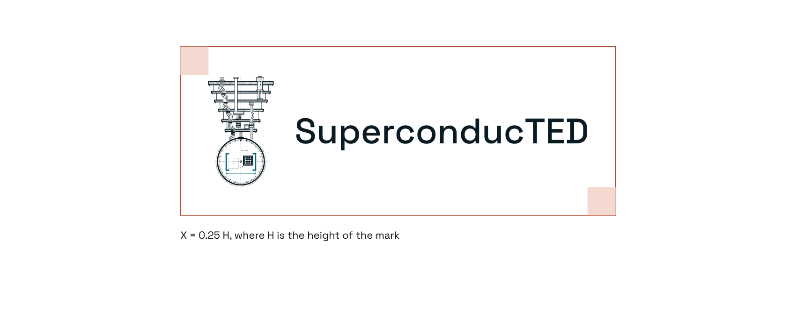
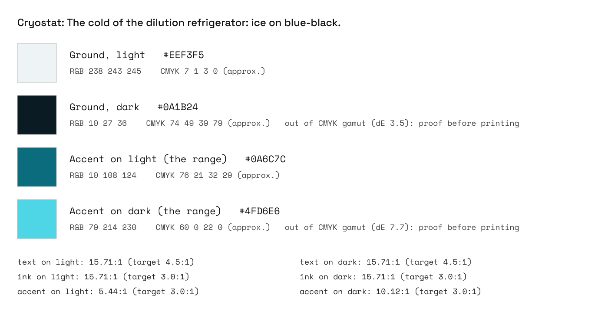
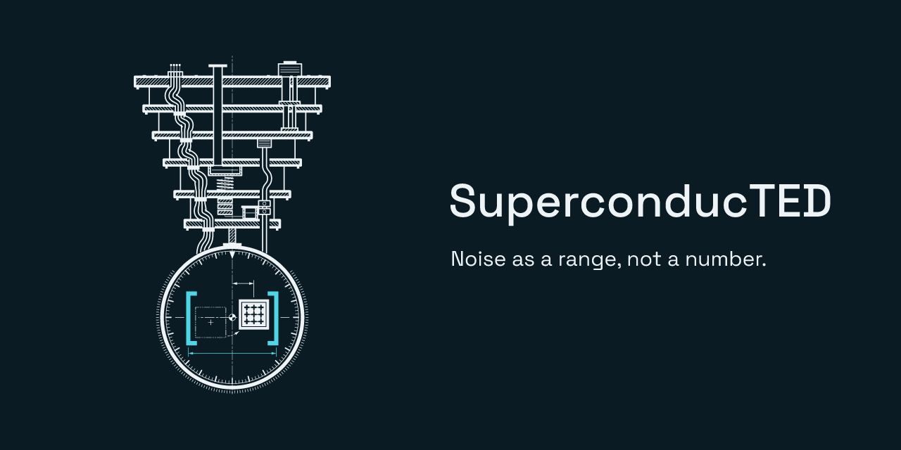
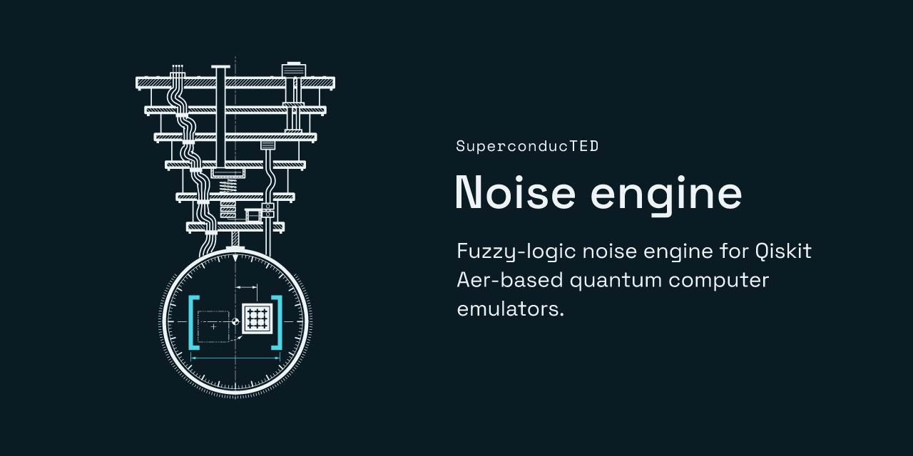
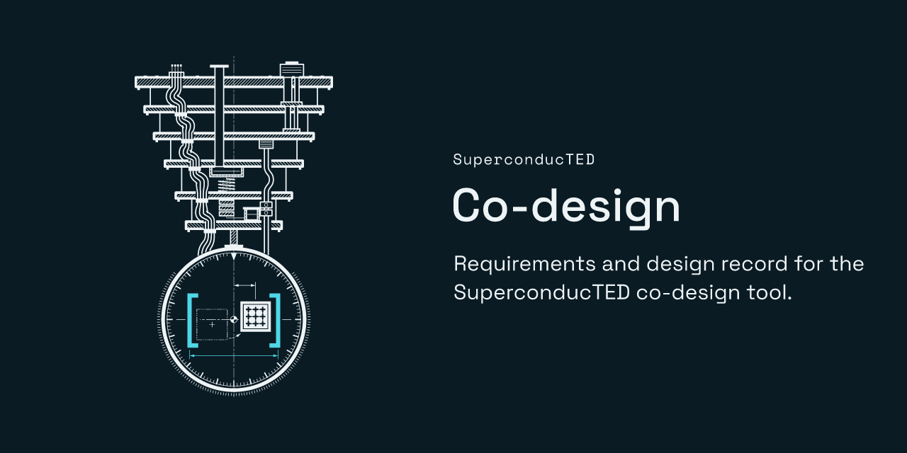

<p align="center">
  <picture>
    <source media="(prefers-color-scheme: dark)" srcset="svg/superconducted-horizontal-on-dark.svg">
    
  </picture>
</p>

# SuperconducTED brand guide

The identity of SuperconducTED: the cutaway mark, its lockups, colours, type and files. Every
asset here is drawn by [`tools/build_brand.py`](tools/build_brand.py) in VectorCraft from the
mark's geometry in [`mark/mark.py`](mark/mark.py), and checked by
[`tools/check_brand.py`](tools/check_brand.py). Edit the numbers in the scripts, not the exported
files.

- **Mark:** the technical cutaway (the team's choice, 2026-10-16).
- **Palette:** Cryostat (the owner's choice, 2026-10-16).
- **Tagline:** "Noise as a range, not a number."


## The idea

Qiskit can describe an IBM quantum computer in one line, `NoiseModel.from_backend`, by freezing
its latest calibration. The machine does not stay frozen: its noise drifts from one calibration
to the next. SuperconducTED keeps every calibration and answers with the range the machine
moves through, not one crisp number. The full story, positioning, boilerplate, naming rules and
voice are in [`FOUNDATION.md`](FOUNDATION.md).

The mark is an engineering drawing of that story, on one centre line:

- **The refrigerator is the real hardware.** A sectioned side view of the dilution refrigerator
  whose coldest plate holds the chip, coldest at the bottom.
- **The dial is the frozen calibration.** A graduated ring under the coldest plate. Where the
  refrigerator's centre line crosses it, a drafting datum marks where the one `from_backend`
  snapshot says the chip is.
- **The phantom chip is the drift.** The chip sits off that datum; its earlier position is drawn
  in phantom line (the drafting convention for the other positions of a moving part), joined to
  the present one by a dashed drift path.
- **The brackets are the engine's answer.** Bold `[ ]` and a dimension line enclose every
  position, past and present. The datum lies at the interval's centre, and every position the
  chip has taken lies inside it: the range is drawn around what the machine actually did.

**Why not a Bloch sphere?** A sphere, an atom, a qubit glyph or IBM's eight bars are the
motifs quantum brands share, and none of them says what this project does. The mark draws the
field's real machine as an engineer would, and dimensions the range.

**How it meets the brief:**

| Principle | How the mark answers it |
| --- | --- |
| Simplicity | Set aside by the owner on 2026-10-15 in favour of depth ("oversimplicity is the problem"). Simplicity survives where recognition needs it: one centre line, one colour rule, a bold small mark for small sizes, and a true one-colour version. |
| Significance and purpose | Every element is a sentence of the story. A stranger's reading: "a quantum computer's refrigerator drawn like a blueprint; a dial shows the chip has drifted off its calibrated centre, and bold brackets mark the range it moves within." |
| Ingenuity | The drawing speaks engineering's own language: section hatching, centre lines, phantom lines, dimension lines. The range is literally dimensioned. It works from a 1280 px banner to a 16 px favicon through a redrawn small mark, and in one colour. |
| Uniqueness | No sphere, atom, qubit glyph, eight bars or Qiskit symbol. No systematic search of other marks has been made; that check belongs with the trademark note below. |
| Beauty is not enough | Every number is in a script: the geometry in `mark/mark.py`, every layout in `tools/build_brand.py`, every colour in `tools/palettes.py`, with checks (`tools/check_brand.py`, `mark/check_api.py`, `figures/check_styles.py`) that fail on a wrong file, a stray colour or a contrast miss. |

## The mark

<p>
  
</p>

**This mark is real engineering, not generated art.** Every plate, cable, tick, dash and bracket
is computed from a number or formula in [`mark/mark.py`](mark/mark.py), and the full mathematics
is written out in **[`CONSTRUCTION.md`](CONSTRUCTION.md)**: the design space and dash phases, the
45° hatch grid, the Bézier coax loom, the helix, the dial's graduations, the chip's lattice, the
interval equations, the small marks' pixel grids, and how each number becomes a minimum size.
Five construction sheets draw the same numbers from the mark's own geometry, so they cannot drift
from the art:

| Sheet | Shows |
| --- | --- |
| [1. Overview](guide/construction-1-overview.png) | The mark on its 1000-unit design grid, the centre line, the visible box, the plate rows |
| [2. Refrigerator](guide/construction-2-refrigerator.png) | Plates, rods, bores, the coax loom's Bézier curves, the helix, the section hatching |
| [3. Dial](guide/construction-3-dial.png) | Radii, the 3° and 15° graduations, the index, the knurl, the datum symbol |
| [4. Interval](guide/construction-4-interval.png) | The chip and its lattice, the drift Bézier and its control points, the bracket equations |
| [5. Lines and small marks](guide/construction-5-lines-and-small-marks.png) | Line weights and dash patterns at scale; the 32-unit and 16-unit small marks on their grids |

All values are in design units, 1000 to the side of the hero's square:

- **Centre line.** Everything hangs on the refrigerator's axis at x = 500.
- **Dial and datum.** The dial's centre (500, 748) is the datum: where the frozen snapshot says
  the chip is. The dial's band is 10 units, its radius 200.
- **Drift.** The chip now sits 60 units right of the datum; its earlier position, in phantom
  line, 60 units left.
- **Interval.** The brackets span 384 to 616 (232 units) and enclose both positions with 14 units
  of clearance; the bracket bars are 12 units thick. Their inner edges fall on the lowest pair
  of support rods.
- **Place and align by the visible art,** not the square: it is 0.547 wide and 0.940 tall of the
  square (`mark.box("hero")`).

Three line weights carry the drawing, with solid shapes above them:

| Weight | Units | Draws |
| --- | --- | --- |
| Heavy | 7.0 | Plate sections |
| Medium | 3.4 | Rods, tubes, coax and output lines, pots, major ticks |
| Fine | 1.4 | Section hatching, centre lines, phantom and hidden lines, dimension lines, minor ticks |
| Solid | 12 (brackets), 10 (dial band) | The brackets, the dial band, the chip, clamps, the index, arrowheads, the datum |

**Small mark (16 to 64 px).** Below 128 px the hero's detail blurs, so the small sizes use a
redrawn mark, not a scaled one: the dial band, the snapshot index on the axis, the chip off it,
and bold brackets, on a 32-unit grid with every edge on a whole unit. A hand-hinted 16-unit
version gives the 16 px files. Files: `superconducted-mark-small-*`. Construction notes:
[`mark/NOTES.md`](mark/NOTES.md).

### The accent means the range

**The accent colour marks the range, and nothing else.** The brackets and the dimension line that
spans them, the band on a chart: whatever is the engine's answer wears the accent. The machine,
the measurement, the type and all other line work wear ink. `mark/check_api.py` proves it with a
pixel test: drawn with a distinct accent, every changed pixel lies on the range.

## Lockups

| Lockup | Use it for | File stem |
| --- | --- | --- |
| **Horizontal** (primary) | Headers, documents, banners | `superconducted-horizontal-*` |
| **Compact** | Navigation bars, 20 to 64 px tall | `superconducted-compact-*` |
| **Stacked** | Square and portrait spaces | `superconducted-stacked-*` |
| **Mark** | Avatars, icons, stickers; the small mark below 128 px | `superconducted-mark-*`, `superconducted-mark-small-*` |

Proportions, in units of the visible mark height H (Hs for the small mark), from the constants in
`tools/build_brand.py`:

- **Horizontal.** The wordmark starts 0.20 H right of the mark, its capitals 0.22 H tall,
  centred on the mark.
- **Stacked.** The wordmark sits 0.16 H below the mark, capitals 0.15 H tall, on one axis.
- **Compact.** The small mark, then the wordmark 0.30 Hs to its right, capitals 0.42 Hs tall.

Type is sized by its capital height: with C₁₀₀ the measured height of an outlined capital H at
100 pt, a cap height c needs 100 · c / C₁₀₀ pt.

### Clear space



Keep at least **X = 0.25 H** free of other text and graphics on every side.

### Minimum sizes

Derived from the geometry ([`CONSTRUCTION.md`](CONSTRUCTION.md), section 8): at the hero's
minimum the brackets are 1.6 px wide and the dial band 1.4 px; the heavy plate lines are just
under 1 px and the fine lines become texture. In print the hero keeps its brackets at 0.45 mm or
more, and every lockup keeps the wordmark's capitals at least 2 mm tall.

| Asset | Screen | Print | Below that |
| --- | --- | --- | --- |
| Hero mark | 128 px tall | 35 mm tall | Use the small mark |
| Horizontal | 430 px wide (128 px tall) | 118 mm wide (35 mm tall) | Use the compact lockup |
| Stacked | 225 px wide | 62 mm wide | Use the small mark |
| Compact | 20 px tall, 125 px wide | 5 mm tall | Use the small mark alone |
| Small mark | 16 px | 4 mm | Do not go smaller |

## Colour



The cold of the dilution refrigerator: ice on blue-black, the machine the engine emulates.
Values from [`tools/palettes.py`](tools/palettes.py) (`CHOSEN = "cryostat"`) and
[`guide/palette.json`](guide/palette.json):

| Role | Hex | RGB | CMYK (approx.) | Contrast |
| --- | --- | --- | --- | --- |
| Dark ground; ink and type on light | `#0A1B24` | 10 27 36 | 74 49 39 79 * | 15.71:1 with the light ground |
| Light ground; ink and type on dark | `#EEF3F5` | 238 243 245 | 7 1 3 0 | 15.71:1 with the dark ground |
| Accent on light grounds (the range) | `#0A6C7C` | 10 108 124 | 76 21 32 29 | 5.44:1 on the light ground |
| Accent on dark grounds (the range) | `#4FD6E6` | 79 214 230 | 60 0 22 0 * | 10.12:1 on the dark ground |

- **Contrast** (WCAG 2.x, `tools/wcag.py`, checked by `tools/check_brand.py`): type needs 4.5:1
  and marks 3:1. All are met, and both accents also clear 4.5:1, so they may carry text.
- **\* Out of the CMYK gamut.** CMYK is VectorCraft's conversion through its "Generic CMYK
  (SWOP-like)" profile. The dark ground (colour difference 3.5) and the bright accent (7.7) fall
  outside it: proof them before any print run. No Pantone references are defined yet.
- **One colour.** Every mark and lockup also comes in solid black and solid white with real
  knock-outs: use them on photographs, busy grounds and anything printed in one ink. The mark
  never depends on colour to be recognised.
- **The options considered** (Heat leak, Copper stage, Phosphor, Figure, Monochrome) stay
  defined in `palettes.py`; each of them on each candidate is in
  [`history/decision/palettes.png`](history/decision/palettes.png).

## Typography

Two families, one lineage: Space Grotesk is "a proportional sans-serif typeface variant based
on" Colophon Foundry's Space Mono (Space Grotesk's own README), so the pair reads as one voice.

| Typeface | Role | Setting | Licence and source |
| --- | --- | --- | --- |
| **Space Grotesk** | The wordmark, headings, running text, the tagline | Wordmark and headings Medium; text and tagline Regular | SIL OFL 1.1, `github.com/floriankarsten/space-grotesk` |
| **Space Mono** | Code, data labels, kickers, small technical captions | Regular; kickers keep normal casing (the name stays SuperconducTED), +60 tracking | SIL OFL 1.1, `github.com/google/fonts` (`ofl/spacemono`) |

Logo files carry their letters as outlines and need no fonts installed. Never retype the
wordmark; use the files. To rebuild, install both into VectorCraft with
`python -I brand/tools/install_fonts.py <folders with the TTFs>`.

## Charts

The project's figures share one style: the **interval band** in the accent (a solid tint at
coverage 0.20, edged in the accent), the **crisp line** for a single-snapshot prediction (ink,
dashed) and the **measured points** in ink, plus up to six series colours. Use
`figures/styles/superconducted.mplstyle` (Cryostat) or the helper:

```python
import superconducted_figures as sf   # from brand/figures/
sf.use()                              # Cryostat, light ground; sf.use(dark=True) for dark
sf.band(ax, x, lo, hi, label="Engine interval")
sf.crisp(ax, x, y, label="Single snapshot")
sf.measured(ax, x, y, label="Measured")
```

Details, validation and demos for every palette: [`figures/`](figures/).

## Files

| Folder | Contents | Use for |
| --- | --- | --- |
| [`svg/`](svg/) | Every mark and lockup in every colour variant, text as outlines | Web, apps, slides, anything that takes SVG; scales without limit |
| [`png/`](png/) | The same with transparent backgrounds: marks at 128 to 1024 px, small marks at 16 to 64 px, lockups at 1x, 2x and 4x | Documents and tools that do not take SVG; use @2x on dense screens |
| [`pdf/`](pdf/) | Marks and lockups, one per file | Print shops, LaTeX (`\includegraphics`), office documents |
| [`eps/`](eps/) | Marks and lockups, one per file | Older print and sign-making workflows |
| [`web/`](web/) | Avatar, favicons, app icons, the profile banner, social cards, the engine's README header | The organisation's online presence (below) |
| [`source/`](source/) | The compressed `.vectorcraft` document behind each file | Editing in VectorCraft |
| [`guide/`](guide/) | The construction sheets, palette (hex, RGB, CMYK, ratios, gamut), clear space, brand board | This guide and [`CONSTRUCTION.md`](CONSTRUCTION.md) |
| [`manifest.json`](manifest.json) | Every file the build wrote, with its colours and sizes | `tools/check_brand.py` |
| [`mark/`](mark/) | The mark's geometry, its acceptance tests and construction notes | Changing the mark |
| [`figures/`](figures/) | The chart style, its helper, checks and demos | Figures in papers, slides and the engine |
| [`history/`](history/) | The four candidates, the brief, the mark API and the team's decision sheets | How the identity was chosen |
| [`LICENSE-BRAND.md`](LICENSE-BRAND.md) | The licence for the brand files: CC BY 4.0 | Read it before using a file outside the organisation's projects |

**Colour variants.**

- `on-light`: ink and the dark accent, for light grounds.
- `on-dark`: light ink and the bright accent, for dark grounds.
- `black` and `white`: one colour.

**The web set** (`web/`):

| File | Size | Use |
| --- | --- | --- |
| `avatar-500.png`, `avatar-1024.png` | 500, 1024 px | GitHub organisation avatar and other profile pictures |
| `favicon.svg`, `favicon-16/32/48.png` | 16 to 48 px | Browser tabs: the small mark on a tile, the hinted drawing at 16 px |
| `app-icon-180/192/512.png` | 180 to 512 px | Home-screen and app icons |
| `profile-header.svg`, `.png`, `@2x.png` | 1280 x 340 | The organisation profile banner |
| `social-card.png` and two repository cards | 1280 x 640 | Social previews (see "Social cards") |
| `readme-header-noise-engine.svg`, `.png`, `@2x.png` | 1280 x 320 | The top of the engine's README |

**Favicon markup.** VectorCraft writes no `.ico`; if one is ever needed, combine
`favicon-16/32/48.png` with any icon tool.

```html
<link rel="icon" href="/favicon.svg" type="image/svg+xml">
<link rel="icon" href="/favicon-32.png" sizes="32x32" type="image/png">
<link rel="apple-touch-icon" href="/app-icon-180.png">
```

**If you generate ideas with AI tools,** ask explicitly for clean vector art, flat colour, no
gradients, no shadows and a solid background, then redraw the result here. Never ship an AI
raster as part of the identity.

## Don't

- Don't give the accent to anything but a range.
- Don't recolour outside the palette, or add gradients, shadows, glows, outlines or textures.
- Don't use the hero below 128 px; use the small mark.
- Don't stretch, skew, rotate or rearrange any part of a mark or lockup.
- Don't retype the wordmark or set it in another typeface.
- Don't place the colour versions on busy photographs; use solid black or white there.
- Don't crowd it: respect the clear space.
- Don't use the TED or TED University emblem or colours with it, or imply endorsement by IBM, the
  Qiskit project, TED or TED University.

## Tagline

> Noise as a range, not a number.

The engine's thesis in seven words, and the colour rule said aloud: the mark carries the story,
the tagline the claim. Chosen by the owner on 2026-10-16 from three candidates.

- Set it in Space Grotesk Regular, sentence case, with its full stop.
- It stays in English on every page, including the Turkish website.
- It is not part of any lockup. Keep it at least the clear space X away from the logo.
- `web/social-card.png` (1280 x 640) carries the horizontal lockup and the tagline.



## Social cards

Each repository shows its own card when a link to it is shared:

| Repository | Card | Also uses |
| --- | --- | --- |
| `.github` | `web/social-card.png`, the organisation card with the tagline | The profile banner `web/profile-header.svg` (copied to the repository root as `header.svg`) |
| `superconducted-noise-engine` | `web/social-card-noise-engine.png` | The README header `web/readme-header-noise-engine.svg`; the chart style in `figures/` |
| `superconducted-codesign` | `web/social-card-codesign.png` | |
| `superconducted.github.io` | (the website's own `og:image` is the noise-engine card) | The favicons, app icons, compact lockup and mark, copied by its `scripts/sync_brand.py` |

**Card layout:** the mark on the dark ground, on the left; on the right, centred vertically, a
"SuperconducTED" kicker in Space Mono (the name keeps its own casing; capitals belong only to
lettering drawn into a mark), the repository's name in the wordmark's Space Grotesk Medium, and
one line in Space Grotesk Regular. The organisation's card has no kicker and carries the tagline.
The build stops if a line is wider than the 580 px text column. To change a card, edit
`REPO_CARDS` in `tools/build_brand.py`.

**Uploading a card:** GitHub has no API for it. In the repository, go to **Settings**, then
**General**, then **Social preview**, then **Edit**, then **Upload an image** (PNG under 1 MB;
these are about 50 KB).

 

## Projects

This is the organisation's identity, and every project wears it as is for now. A project that
later needs its own mark builds it in the same drawing language (the centre line, the dial, the
dimensioned range) and under the same colour rule, as a variant in `tools/build_brand.py`, never
by hand.

## Rebuilding

Needs VectorCraft 0.10 or later, Python 3.10 or later (standard library only) and the two
typefaces installed in VectorCraft. VectorCraft 0.10 writes nothing at 260 or more path
characters, so build into a short folder and copy the result in. From the repository root:

```bash
python -I brand/tools/palettes.py
python -I brand/tools/build_brand.py --out C:/t-kit
# copy C:/t-kit/{eps,guide,pdf,png,source,svg,web} and C:/t-kit/manifest.json into brand/
python -I brand/tools/check_brand.py brand
python -I brand/mark/check_api.py
```

`build_brand.py` defaults to the chosen mark and palette; `--mark` and `--palette` build any other
combination, and `--decision --scratch <folder>` rebuilds the decision sheets in
`history/decision/`. The check exits non-zero on any failure, and verifies that:

- every file the manifest promises exists;
- every SVG has a title and a viewBox, no live text, images or external references, and only its
  variant's colours;
- every PNG has the right pixel size and, where required, a transparent background;
- the palette meets its contrast targets.

SVG output is byte-identical from run to run. PNG output is identical pixel for pixel but not
byte for byte, because VectorCraft stamps each PNG with its creation time, so a rebuild shows
every PNG as changed in git. Commit a regenerated PNG only when its pixels changed: compare the
decoded pixels first (`png_read` in `tools/check_brand.py`) and restore the committed file when
they match.

## How this answers the brief

| Brief section | Where it is answered |
| --- | --- |
| 1. Scalability and versatility | Hero plus a redrawn small mark; one-colour versions; favicons; minimum sizes; `check_brand.py` |
| 2. Strategic alignment and rationale | [`FOUNDATION.md`](FOUNDATION.md); "The idea" and the colour rule above; the mathematics in [`CONSTRUCTION.md`](CONSTRUCTION.md) |
| 3. Colour and accessibility | Cryostat with hex, RGB, CMYK, WCAG ratios and gamut notes; chart colours checked for colour-vision deficiency |
| 4. Typography | Space Grotesk and Space Mono, roles and settings above |
| 5. Structural layout and lockups | Horizontal (primary), compact, stacked, mark alone; clear space; minimum sizes |
| 6. File and production readiness | SVG, PNG, PDF, EPS and sources; the web set; favicon markup; the AI-tools note |

## Notes

- **The name.** The TED in SuperconducTED is TED University in Ankara, where the team studies;
  the university was founded by Türk Eğitim Derneği (the Turkish Education Association, TED)
  under a 2009 law. The university publishes its own corporate identity guide for its logo; this
  identity uses none of its elements, nor those of TED. Using the university's name beyond
  GitHub and the website (events, print, merchandise) should be confirmed with the university
  first.
- **Trademark.** TED Conferences, LLC holds a registered US word mark "TED" (registered in 2010
  and renewed in 2019, per public trademark records) and enforces it against names that suggest
  a link with TED. SuperconducTED is not affiliated with TED Conferences, and the identity draws
  nothing from its marks; but a name ending in capital TED can be read that way, so a trademark
  check is advisable before any commercial use of the name. This is a note, not legal advice.
- **Domains.** The website is <https://superconducted.github.io/> (GitHub Pages, 2026-10-16); a
  custom domain may follow. `superconducted.com` and `superconducted.org` are registered to
  someone else (since 2025-07-18) and are not the organisation's.
- **How it was chosen.** Four rounds over 2026-10-15 and 2026-10-16: the story first, then four
  detailed candidates drawn in parallel, a team vote for the technical cutaway, and the owner's
  choice of palette and tagline. The candidates and the decision sheets are in
  [`history/`](history/); the design record is in
  [`2026-10-15-superconducted-brand-identity.md`](../docs/implementations/2026-10-15-superconducted-brand-identity.md)
  and [`2026-10-16-superconducted-brand-system.md`](../docs/implementations/2026-10-16-superconducted-brand-system.md).

## Licence

The brand files are CC BY 4.0 and the scripts MIT: see [`LICENSE-BRAND.md`](LICENSE-BRAND.md),
which also covers the fonts and what using the marks does not imply, and the repository's
[`NOTICE`](../NOTICE).
