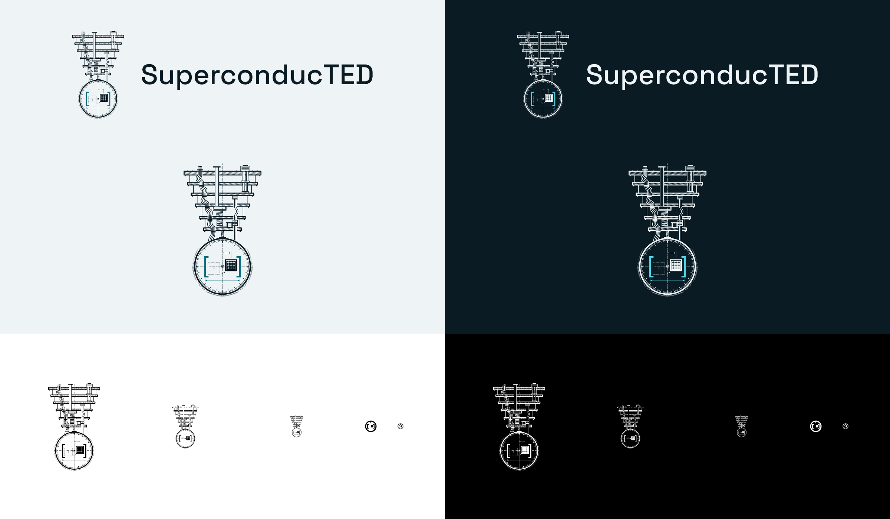

<p align="center">
  <picture>
    <source media="(prefers-color-scheme: dark)" srcset="kit/svg/superconducted-horizontal-on-dark.svg">
    
  </picture>
</p>

# SuperconducTED brand guide

> **The identity, 2026-10-16.** Mark: the **technical cutaway** (the team's choice).
> Palette: **Cryostat** (the owner's choice). Tagline: **"Noise as a range, not a number."**
> Every file is in [`kit/`](kit/), drawn by [`tools/build_brand.py`](tools/build_brand.py) in
> VectorCraft and verified by [`tools/check_brand.py`](tools/check_brand.py). Edit the numbers
> in the scripts, never the exported files.



## The idea

Qiskit can describe an IBM quantum computer in one line, `NoiseModel.from_backend`, by freezing
its latest calibration. The machine does not stay frozen: its noise drifts from one calibration
to the next. SuperconducTED keeps every calibration and answers with the range the machine
moves through, not one crisp number. The full story, positioning, boilerplate, naming rules
and voice are in [`FOUNDATION.md`](FOUNDATION.md).

The mark is an engineering drawing of that story, on one centre line:

- **The refrigerator.** A sectioned side view of the dilution refrigerator whose coldest plate
  holds the chip: real hardware, coldest at the bottom.
- **The calibration dial.** A graduated ring under the coldest plate. Where the refrigerator's
  centre line crosses it, a drafting datum marks the point where the frozen calibration (the
  one `from_backend` snapshot) says the chip is.
- **The drifting chip.** The chip sits off that datum; its earlier position is drawn in phantom
  line (the drafting convention for the other positions of a moving part), joined by a dashed
  drift path.
- **The interval.** Bold `[ ]` and a dimension line enclose every position, past and present:
  the engine's answer. The frozen snapshot (the datum) lies inside it, and so does every
  position the chip has taken since: the range is drawn around what the machine actually did.
  *(Corrected 2026-10-16: an earlier version of this guide said the datum sits off the
  interval's centre. Measured on the drawing, the two chip positions sit 60 units either side
  of the datum, so the interval is centred on it; see the construction drawing below.)*

### How the mark meets the brief

The owner's brief opened with five principles. How the technical cutaway answers each:

| Principle | How the mark answers it |
| --- | --- |
| **Simplicity** | Set aside by the owner on 2026-10-15 in favour of depth ("oversimplicity is the problem"). Simplicity survives where it matters for recognition: one centre line, one colour rule, a bold small mark for small sizes, and a true one-colour version. |
| **Significance and purpose** | Every element is a sentence of the story: the refrigerator is the real hardware, the dial's datum is the frozen `from_backend` snapshot, the phantom chip is the drift, and the brackets are the engine's answer. A stranger's reading: "a quantum computer's refrigerator drawn like a blueprint; a dial shows the chip has drifted off its calibrated centre, and bold brackets mark the range it moves within." |
| **Ingenuity** | The drawing speaks engineering's own language: section hatching, centre lines, phantom lines for a moving part's other positions, dimension lines. The range is literally dimensioned. It works from a 1280 px banner to a 16 px favicon through a redrawn small mark, and in one colour. |
| **Uniqueness** | No Bloch sphere, no atom, no qubit glyph, no IBM eight-bar stripes or Qiskit symbol: the motifs quantum brands share. The mark draws the field's real machine, the dilution refrigerator, as an engineering drawing rather than as a symbol. No systematic search of other marks has been made; that check belongs with the trademark note below. |
| **Beauty is not enough to sell** | Every number is in a script: the mark's geometry in `candidates/cutaway/mark.py`, every layout in `tools/build_brand.py`, every colour in `tools/palettes.py`, with checks (`check_brand.py`, `check_api.py`, `check_styles.py`) that fail on a wrong file, a stray colour or a contrast miss. |

## The one colour rule

**The accent colour means the range, and nothing else.** The brackets and the dimension line
that spans them, the band on a chart: whatever is the engine's answer wears the accent. The
machine, the measurement, the type and all other line work wear ink. Each candidate mark proves
this rule with a pixel test (`candidates/<style>/check_api.py`): with a distinct accent, every
changed pixel lies on the range.

## Colour: Cryostat

The cold of the dilution refrigerator: ice on blue-black, the machine the engine emulates.
Values from [`tools/palettes.py`](tools/palettes.py) (`CHOSEN = "cryostat"`) and the kit's
[`guide/palette.json`](kit/guide/palette.json):

| Role | Hex | RGB | CMYK (approx.) | Contrast |
| --- | --- | --- | --- | --- |
| Dark ground; ink and type on light | `#0A1B24` | 10 27 36 | 74 49 39 79 * | 15.71:1 with the light ground |
| Light ground; ink and type on dark | `#EEF3F5` | 238 243 245 | 7 1 3 0 | 15.71:1 with the dark ground |
| Accent on light grounds (the range) | `#0A6C7C` | 10 108 124 | 76 21 32 29 | 5.44:1 on the light ground |
| Accent on dark grounds (the range) | `#4FD6E6` | 79 214 230 | 60 0 22 0 * | 10.12:1 on the dark ground |

- **Targets** (WCAG 2.x): type at least 4.5:1, marks and accents at least 3:1. All met; both
  accents also clear 4.5:1, so they may carry text.
- **\* Out of the CMYK gamut.** CMYK is VectorCraft's conversion through its "Generic CMYK
  (SWOP-like)" profile. The dark ground (colour difference 3.5) and the bright accent (7.7)
  fall outside it: proof them before any print run. No Pantone references are defined yet.
- **One colour.** Every mark and lockup also comes in solid black and solid white with real
  knock-outs: use them on photographs, busy grounds, and anything printed in one ink.
- **Charts** use the same palette (below); a chart can show up to six series colours.
- **The options considered** (Heat leak, Copper stage, Phosphor, Figure, Monochrome) remain
  defined in `palettes.py`; each of them on each candidate is in
  [`decision/palettes.png`](decision/palettes.png).

## Typography

Two families, one lineage: Space Grotesk is "a proportional sans-serif typeface variant based
on" Colophon Foundry's Space Mono (Space Grotesk's own README), so the pair reads as one voice.

| Typeface | Role | Setting | Licence and source |
| --- | --- | --- | --- |
| **Space Grotesk** | The wordmark, headings, running text, the tagline | Wordmark and headings Medium; text and tagline Regular | SIL OFL 1.1, `github.com/floriankarsten/space-grotesk` |
| **Space Mono** | Code, data labels, kickers, small technical captions | Regular; kickers keep normal casing (the name stays SuperconducTED), +60 tracking | SIL OFL 1.1, `github.com/google/fonts` (`ofl/spacemono`) |

Install both into VectorCraft with `python -I brand/tools/install_fonts.py <folders with the
TTFs>`. Logo files carry their letters as outlines and need no fonts; never retype the
wordmark, use the files.

## The mark

<p>
  
</p>

**This mark is real engineering, not generated art.** Every plate, cable, tick, dash and
bracket is computed from a number or formula in
[`candidates/cutaway/mark.py`](candidates/cutaway/mark.py), and the full mathematics is written
out in **[`CONSTRUCTION.md`](CONSTRUCTION.md)**: the design space and dash phases, the 45° hatch
grid, the Bézier coax loom, the helix's front and back, the dial's graduations, the chip's
lattice, the interval equations, the small marks' pixel grids, and how each number becomes a
minimum size. Five construction sheets draw the same numbers, all generated from the mark's own
geometry so they cannot drift from the art:

| Sheet | Shows |
| --- | --- |
| [1. Overview](kit/guide/construction-1-overview.png) | The mark on its 1000-unit design grid, the centre line, the visible box, the plate rows |
| [2. Refrigerator](kit/guide/construction-2-refrigerator.png) | Plates, rods, bores, the coax loom's Bézier curves, the helix, the section hatching |
| [3. Dial](kit/guide/construction-3-dial.png) | Radii, the 3° and 15° graduations, the index, the knurl, the datum symbol |
| [4. Interval](kit/guide/construction-4-interval.png) | The chip and its lattice, the drift Bézier and its control points, the bracket equations |
| [5. Lines and small marks](kit/guide/construction-5-lines-and-small-marks.png) | Line weights and dash patterns at scale; the 32-unit and 16-unit small marks on their grids |

The essentials:

- **Centre line.** Everything hangs on the refrigerator's axis at x = 500 of 1000.
- **Dial and datum.** The dial's centre (500, 748) is the datum: where the frozen snapshot says
  the chip is. The dial's band is 10 units, its radius 200.
- **Drift.** The chip now sits 60 units right of the datum; its earlier position, in phantom
  line, 60 units left.
- **Interval.** The brackets span 384 to 616 (232 units) and enclose both positions with 14
  units of clearance; the bracket bars are 12 units thick.

The hero is drawn in a design space of 1000 units (1024 px in the kit's 1024 px files); its
visible art is 0.547 wide and 0.940 tall of that square (`mark.box("hero")`). Three line
weights carry the drawing, with solid shapes above them:

| Weight | Units | Draws |
| --- | --- | --- |
| Heavy | 7.0 | Plate sections |
| Medium | 3.4 | Rods, tubes, coax and output lines, pots, major ticks |
| Fine | 1.4 | Section hatching, centre lines, phantom and hidden lines, dimension lines, minor ticks |
| Solid | 12 (brackets), 10 (dial band) | The brackets, the dial band, the chip, clamps, the index, arrowheads, the datum |

The **small mark** is a separate drawing for 16 to 64 px: the dial band, the snapshot index on
the axis, the chip off it, and bold brackets, on a 32-unit grid with every edge on a whole
unit; a hand-hinted 16-unit version (`small16`) gives the 16 px files. Full construction notes:
[`candidates/cutaway/NOTES.md`](candidates/cutaway/NOTES.md).

### Minimum sizes

Derived from the geometry: at the hero's minimum the brackets are 1.6 px wide and the dial band
1.4 px; the heavy plate lines are just under 1 px and the fine lines become texture. In print
the hero keeps its brackets at 0.45 mm or more, and every lockup keeps the wordmark's capitals
at least 2 mm tall. Lockup sizes follow from the built files' proportions.

| Asset | Screen | Print | Below that |
| --- | --- | --- | --- |
| Hero mark | 128 px tall | 35 mm tall | Use the small mark |
| Horizontal lockup | 430 px wide (128 px tall) | 118 mm wide (35 mm tall) | Use the compact lockup |
| Stacked lockup | 225 px wide | 62 mm wide | Use the small mark |
| Compact lockup | 20 px tall, 125 px wide | 5 mm tall | Use the small mark alone |
| Small mark | 16 px | 4 mm | Do not go smaller |

## Lockups

Proportions in units of the visible mark height H (Hs for the small mark), from the constants
in `tools/build_brand.py`:

| Lockup | Use it for | Layout | Files |
| --- | --- | --- | --- |
| **Horizontal** (primary) | Headers, documents, banners | Hero, then the wordmark 0.20 H to its right, capitals 0.22 H tall, centred on the mark | `superconducted-horizontal-*` |
| **Stacked** | Square and portrait spaces | Hero, then the wordmark 0.16 H below, capitals 0.15 H tall, one axis | `superconducted-stacked-*` |
| **Compact** | Navigation bars, 20 to 64 px tall | Small mark, then the wordmark 0.30 Hs to its right, capitals 0.42 Hs tall | `superconducted-compact-*` |
| **Mark alone** | Avatars, icons, stickers | Hero from 128 px, the small mark below | `superconducted-mark-*`, `superconducted-mark-small-*` |

**Clear space:** keep X = 0.25 H free on every side ([`kit/guide/clear-space.png`](kit/guide/clear-space.png)).

## Tagline

> Noise as a range, not a number.

The engine's thesis in seven words, and the colour rule said aloud. Set it in Space Grotesk
Regular, sentence case, with its full stop. It is never part of a lockup; keep it at least the
clear space away from the logo. The organisation's social card carries it.

## Charts

The project's figures share one style: the **interval band** in the accent (a solid tint at
coverage 0.20, edged in the accent), the **crisp line** for a single-snapshot prediction (ink,
dashed) and the **measured points** in ink, plus up to six series colours. Use
`figures/styles/superconducted.mplstyle` (Cryostat) or the helper:

```python
import superconducted_figures as sf   # from brand/figures/
sf.use()                              # Cryostat, light ground; sf.use(dark=True) for dark
sf.band(ax, x, lo, hi, label="Engine interval")
sf.crisp(ax, x, y, label="Single snapshot")
sf.measured(ax, x, y, label="Measured")
```

Details, validation and demos for every palette: [`figures/`](figures/). Adopting the style in
the engine's own scripts is a follow-up pull request in that repository.

## Digital applications

| File in `kit/web/` | Size | Use |
| --- | --- | --- |
| `avatar-500.png`, `avatar-1024.png` | 500, 1024 px | GitHub organisation avatar and other profile pictures |
| `favicon.svg`, `favicon-16/32/48.png` | 16 to 48 px | Browser tabs: the small mark on a tile, the hinted drawing at 16 px |
| `app-icon-180/192/512.png` | 180 to 512 px | Home-screen and app icons |
| `profile-header.svg`, `.png`, `@2x.png` | 1280 x 340 | The organisation profile banner (same size as today's `header.svg`) |
| `social-card.png` | 1280 x 640 | The organisation's social preview, with the tagline |
| `social-card-noise-engine.png`, `social-card-codesign.png` | 1280 x 640 | Repository social previews |
| `readme-header-noise-engine.svg`, `.png` | 1280 x 320 | The top of the engine's README |

```html
<link rel="icon" href="/favicon.svg" type="image/svg+xml">
<link rel="icon" href="/favicon-32.png" sizes="32x32" type="image/png">
<link rel="apple-touch-icon" href="/app-icon-180.png">
```

VectorCraft writes no `.ico`; if one is ever needed, combine `favicon-16/32/48.png` with any icon
tool. A social preview is uploaded by hand in each repository's Settings, General, Social
preview (GitHub has no API for it).

## Files and formats

| Folder in `kit/` | Contents | Use for |
| --- | --- | --- |
| `svg/` | Every mark and lockup in every colour variant, text as outlines | Web, slides, anything that takes SVG; scales without limit |
| `png/` | The same with transparent backgrounds: marks at 128 to 1024 px, small marks at 16 to 64 px, lockups at 1x, 2x and 4x | Tools that do not take SVG; use @2x on dense screens |
| `pdf/`, `eps/` | Marks and lockups, one per file | Print shops, LaTeX, older sign-making workflows |
| `web/` | Avatar, favicons, app icons, banner, cards, README header | The organisation's online presence |
| `guide/` | Five construction sheets, palette (hex, RGB, CMYK, ratios, gamut), clear space, brand board | This guide and [`CONSTRUCTION.md`](CONSTRUCTION.md) |
| `source/` | The compressed `.vectorcraft` document behind each file | Editing in VectorCraft |

Colour variants: `on-light` (light grounds), `on-dark` (dark grounds), `black` and `white`
(one colour).

**If you generate ideas with AI tools,** ask explicitly for clean vector art, flat colour, no
gradients, no shadows and a solid background, then redraw the result here. Never ship an AI
raster as part of the identity.

## Don't

- Don't give the accent to anything but a range.
- Don't recolour outside the palette, or add gradients, shadows, glows or textures.
- Don't use the hero below 128 px; use the small mark.
- Don't stretch, skew, rotate or rearrange any part of a mark or lockup.
- Don't retype the wordmark or set it in another typeface.
- Don't use the TED or TED University emblem or colours with it, or imply endorsement by IBM, the
  Qiskit project, TED or TED University.
- Don't place the colour versions on busy photographs; use solid black or white there.

## Rebuilding

Needs VectorCraft 0.10 or later, Python 3.10 or later (standard library only) and the two
typefaces installed. Keep the checkout path short: VectorCraft 0.10 writes no file at 260 or
more path characters. From the repository root:

```bash
python -I brand/tools/palettes.py
python -I brand/tools/build_brand.py --out brand/kit
python -I brand/tools/check_brand.py brand/kit
```

`build_brand.py` defaults to the chosen mark and palette; `--mark` and `--palette` build any
other combination, and `--decision --scratch <folder>` rebuilds the decision record in
`decision/`. SVG output is byte-identical from run to run. PNG output is identical pixel for
pixel but not byte for byte, because VectorCraft stamps each PNG with its creation time; so a
rebuild shows every PNG as changed in git even when nothing visible changed. Commit a
regenerated PNG only when its pixels changed: compare the decoded pixels first (`png_read` in
`tools/check_brand.py`) and restore the committed file when they match.

## How this answers the brief

| Brief section | Where it is answered |
| --- | --- |
| 1. Scalability and versatility | Hero plus a redrawn small mark; one-colour versions; favicons; minimum sizes; `check_brand.py` |
| 2. Strategic alignment and rationale | [`FOUNDATION.md`](FOUNDATION.md); "The idea", the five principles and the colour rule above; the mathematics in [`CONSTRUCTION.md`](CONSTRUCTION.md) |
| 3. Colour and accessibility | Cryostat with hex, RGB, CMYK, WCAG ratios and gamut notes; chart colours checked for colour-vision deficiency |
| 4. Typography | Space Grotesk and Space Mono, roles and settings above |
| 5. Structural layout and lockups | Horizontal (primary), stacked, compact, mark alone; clear space; minimum sizes |
| 6. File and production readiness | SVG, PNG, PDF, EPS and sources; web set; favicon markup; the AI-tools note |

## Projects

This is the organisation's identity; for now every project wears it as is.

| Repository | What it uses |
| --- | --- |
| `superconducted-noise-engine` (the flagship) | The README header `kit/web/readme-header-noise-engine.svg` and the social card `social-card-noise-engine.png`; its figures use the chart style in `figures/` |
| `superconducted-codesign` | The social card `social-card-codesign.png` |
| `.github` (this repository) | The organisation's social card `social-card.png`, with the tagline; the profile banner `profile-header.svg` |

A project that later needs its own mark builds it on the same drawing language (the centre
line, the dial, the dimensioned range) and the same colour rule, and adds its variants to
`tools/build_brand.py` rather than drawing them by hand.

## Notes

- **The name.** The TED in SuperconducTED is TED University in Ankara, where the team
  studies; the university was founded by Türk Eğitim Derneği (the Turkish Education
  Association, TED) under a 2009 law. The university publishes its own corporate identity guide
  for its logo; this identity uses none of its elements, nor those of TED. Using the
  university's name in the organisation's description should be confirmed with the university
  before any launch beyond GitHub (events, print, merchandise).
- **Trademark.** TED Conferences, LLC holds a registered US word mark "TED" (registered in 2010
  and renewed in 2019, per public trademark records) and enforces it against names that suggest
  a link with TED. SuperconducTED is not affiliated with TED Conferences, and the identity draws
  nothing from its marks; but a name ending in capital TED can be read that way, so a trademark
  check is advisable before any commercial use of the name. This is a note, not legal advice.
- **Domains.** `superconducted.com` and `superconducted.org` are registered to someone else (on
  2025-07-18) and show a parked page; they are not the organisation's. The organisation's
  website is still to be chosen.
- **History.** The design record is in
  [`../docs/implementations/2026-10-15-superconducted-brand-identity.md`](../docs/implementations/2026-10-15-superconducted-brand-identity.md)
  and [`2026-10-16-superconducted-brand-system.md`](../docs/implementations/2026-10-16-superconducted-brand-system.md).

## How it was chosen

Four rounds over 2026-10-15 and 2026-10-16: story first, then four detailed candidates drawn in
parallel, a team vote for the technical cutaway, and the owner's choice of palette and
tagline. The record is in [`../docs/implementations/`](../docs/implementations/); the
candidates and the team's decision aids stay in [`candidates/`](candidates/) and
[`decision/`](decision/).

## Licence

The brand files are CC BY 4.0 and the scripts MIT; see [`LICENSE-BRAND.md`](LICENSE-BRAND.md),
which also covers the fonts and the no-endorsement note.
