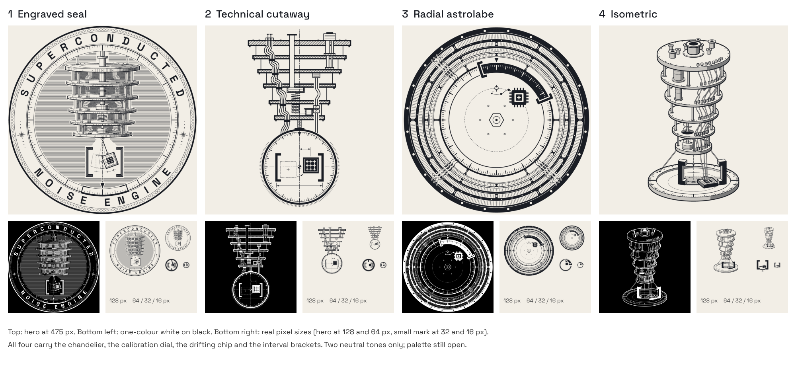
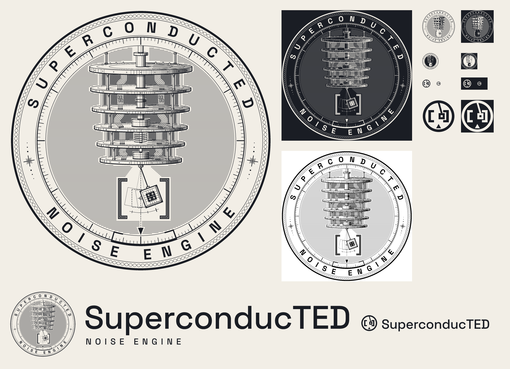
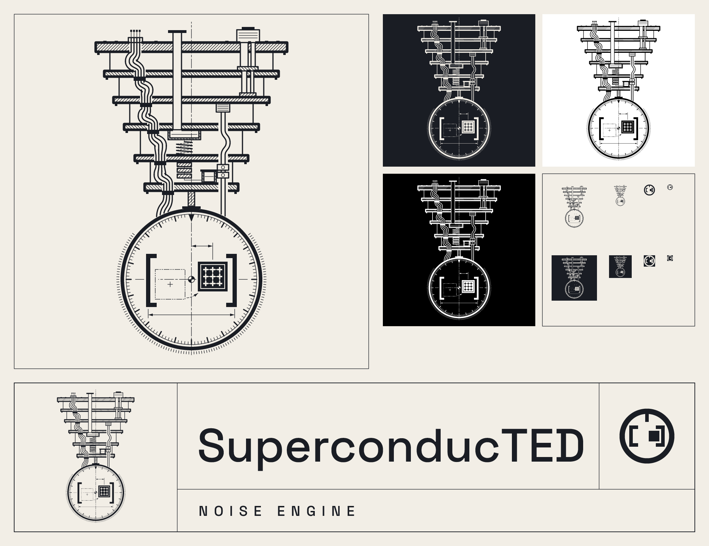
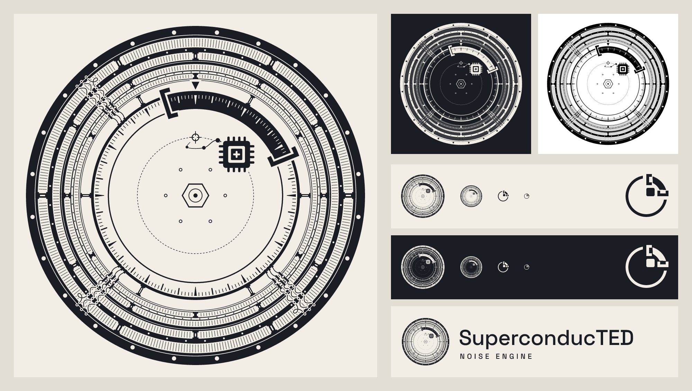
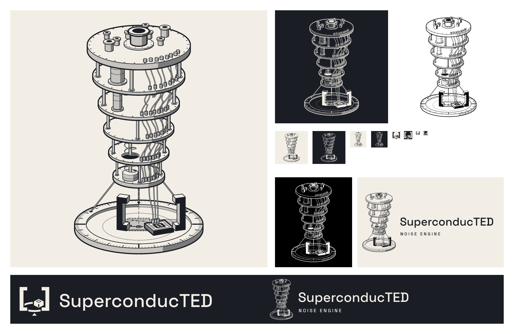
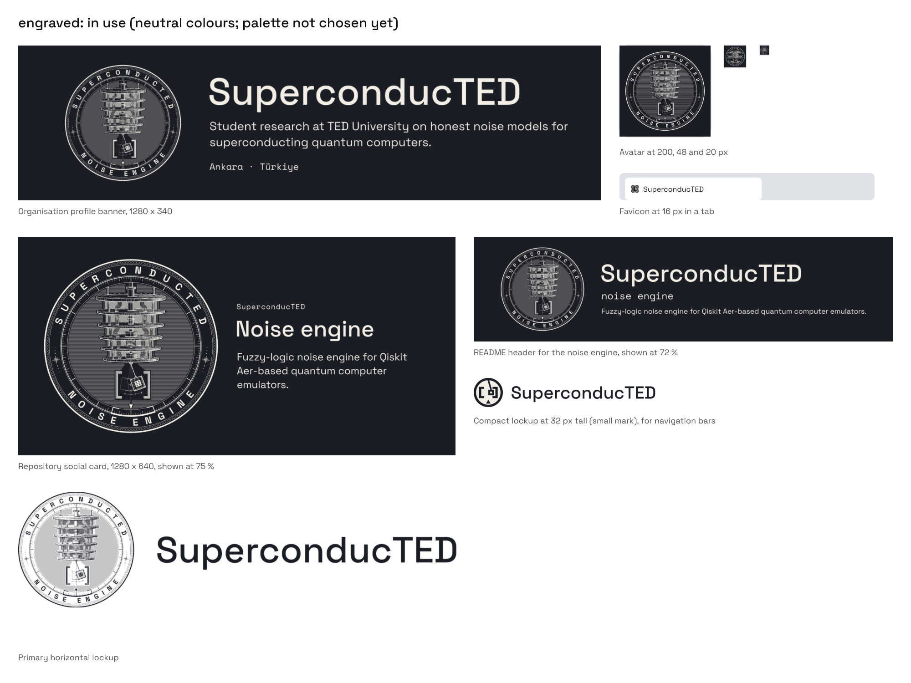
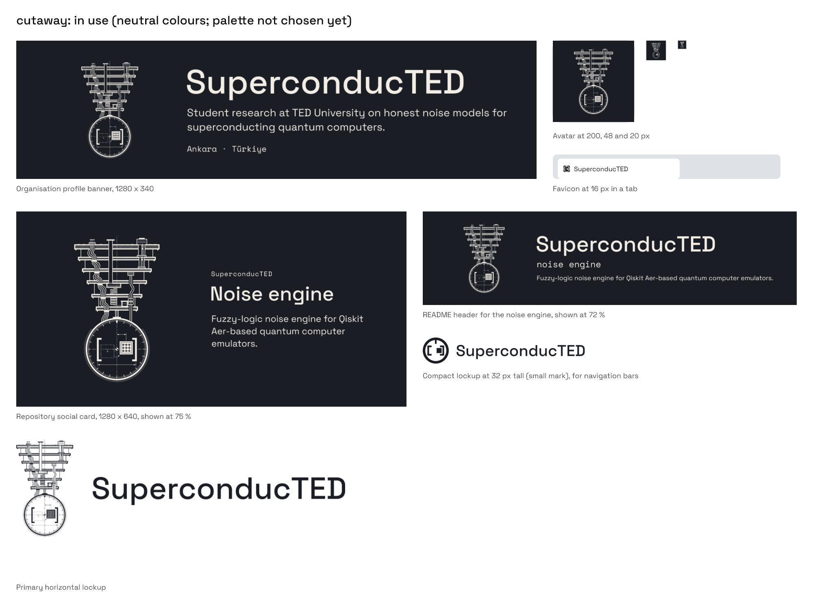
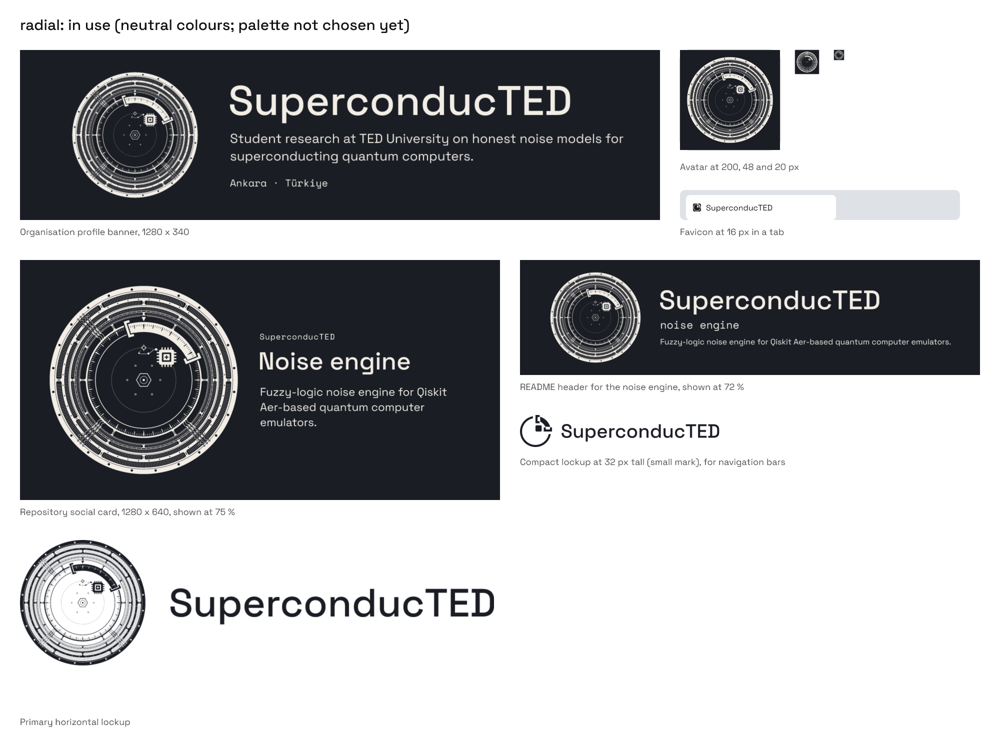

# SuperconducTED logo candidates (round 3)

> **Status, 2026-10-16:** four candidates, all kept. The owner liked all four and is asking the
> team to choose. Nothing here is the official logo yet. The palette and the typeface are still
> open: every candidate is drawn in two neutral tones (ink `#1A1D24`, paper `#F2EEE6`) so the
> choice is about the drawing, not the colour.



*Top: each hero at the same size. Bottom left: the one-colour version (white on black).
Bottom right: real pixel sizes, the hero at 128 and 64 px and the small mark at 32 and 16 px.*

## The story every candidate tells

> Qiskit can describe an IBM quantum computer in one line, `NoiseModel.from_backend`. It reads
> the machine's latest calibration and freezes it into one noise model. The machine does not
> stay frozen: its chip hangs at the bottom of a dilution refrigerator, about a hundredth of a
> degree above absolute zero, and its noise still drifts from one calibration to the next.
> SuperconducTED keeps every calibration and answers with the range the machine actually moves
> through: not one crisp number, but an interval that brackets the real hardware.

Someone who sees the mark with no label should come away with three things: **real quantum
hardware**, **noise that drifts**, and **ranges, not single numbers**. So every candidate draws
the same four elements, each carrying one part of the story:

| Element | What it stands for |
| --- | --- |
| The chandelier (the dilution refrigerator) | The real machine: IBM's chips hang at the bottom, coldest stage of one. |
| A calibration dial | Its index mark is where the frozen calibration (the `from_backend` snapshot) says the machine is. |
| The drifting chip | The machine has moved off that mark: its noise drifted after the snapshot. |
| Interval brackets `[ ]` | The engine's answer: the range the machine moves through, which brackets the real hardware. |

## The four candidates

Each one is a complete drawing: a detailed hero for 128 px and up, a separately drawn small
mark for favicons (16 to 32 px), and a one-colour version. Each folder has a `sheet.png` with
the hero on light and dark grounds, in solid black, at small sizes and in a lockup with the
name, plus a `NOTES.md` from its designer. The strengths and weaknesses below combine each
designer's self-assessment with an independent review on 2026-10-16; they are judgements, not
measurements.

### 1. Engraved seal: [`engraved/`](engraved/)



A banknote-style seal. The chandelier sits at the centre, every stage cross-hatched so the lit
hardware stands forward; the seal's inner ring is the calibration dial, with its index at six
o'clock; the chip hangs off the plumb line inside heavy engraved brackets, and the same
interval is inked on the dial. SUPERCONDUCTED and NOISE ENGINE run around the rim.

- *A stranger's caption:* "An engraved seal of a cryogenic quantum machine: its chip has swung
  off the dial's mark, and heavy brackets catch the whole range it moves through."
- **Strengths:** the most emblem-like and ceremonial of the four; the round shape fits a
  GitHub avatar, a sticker or a poster; the name is built into the mark.
- **Weaknesses:** the spacing of the rim letters is uneven; the chip is drawn *swinging*,
  which is poetic licence (the real chip is fixed; only its noise drifts); the earlier
  positions vanish at 512 px and below, and the fine engraving turns dark grey under 128 px,
  where the small mark takes over.

### 2. Technical cutaway: [`cutaway/`](cutaway/)



An engineering drawing. A sectioned side view of the refrigerator (hatched plates, the coax
loom, the heat-exchanger coil, the mixing-chamber pot) stands on one dash-dot centre line that
runs down into a graduated dial. Where the centre line crosses the dial, a drafting datum marks
the snapshot. The chip sits off it, its earlier position drawn in phantom line (the drafting
convention for the other positions of a moving part), and bold brackets with a dimension line
span the range.

- *A stranger's caption:* "A quantum computer's refrigerator drawn like a blueprint: at its
  cold bottom a dial shows the chip has drifted off its calibrated centre, and bold brackets
  mark the range it moves within."
- **Strengths:** the clearest telling of the story, since one centre line carries it all and the
  drift is the only thing that breaks the symmetry; the drift is drawn truthfully; the lockup
  is an engineering title block.
- **Weaknesses:** it is an emblem-illustration more than a logo, and at 64 px the hero is a
  grey silhouette; the knurled dial can read as a watch; the small mark (a ring with the
  bracketed chip) is the closest of the four to the CASSANDRA Collective's ring at 16 px.

### 3. Radial astrolabe: [`radial/`](radial/)



The chandelier seen from directly below: its plates become concentric rings around the
coldest plate, whose rim is engraved as the dial. Between a `[` and a `]` bent onto the dial,
the dial turns solid and its graduations open as windows: that arc is the range, and the
snapshot index, the chip's trail and the chip all lie inside it.

- *A stranger's caption:* "An engraved precision dial ringed by bolted plates, rods and cables,
  so some kind of serious hardware; a chip has wandered off the dial's mark, and a bracketed
  arc on the dial shows the whole range it moves through."
- **Strengths:** the strongest single image of "a range, not a number"; it reads the same in
  ink on paper, paper on ink and solid black; the most unusual geometry of the four.
- **Weaknesses:** from below, the refrigerator reads as a precision instrument, lens or turbine,
  with some watch or compass association, rather than as a quantum computer; at 16 px the
  sideways `]` can read as a cup or a power symbol.

### 4. Isometric illustration: [`isometric/`](isometric/)



A three-dimensional drawing of the refrigerator from one camera: six bolted plates, eight coax
lines with an attenuator on every stage, the pulse tube and the heat-exchanger coil, shaded
only with flat tints. Below it a dial carries a pair of extruded brackets; inside them the chip
has drifted and twisted away from a dashed ghost on the dial's centre, at the end of a dotted
trail of earlier calibrations.

- *A stranger's caption:* "A cryogenic machine hangs over a measuring dial; its chip has
  wandered off the dial's centre mark, and a pair of square brackets frames the whole range it
  wandered through."
- **Strengths:** the most believable machine and arguably the finest artwork in the set; its
  one-colour version reads like an engraving.
- **Weaknesses:** the drift is the quietest of the four ideas (a modest offset carried by fine
  lines that vanish below about 512 px); the tall, narrow shape fills a square avatar poorly;
  the upright brackets can first read as a stand or a gate.

## At a glance

A reviewer's read on 2026-10-16, not a measurement:

| | Engraved seal | Technical cutaway | Radial astrolabe | Isometric |
| --- | --- | --- | --- | --- |
| Reads as real quantum hardware | Yes | Yes | Weakly | Strongly |
| The drift is visible | Yes | Strongly | Yes | Weakly |
| The range is visible | Yes | Yes | Strongly | Yes |
| Shape for a square avatar | Round, ideal | Tall | Round, ideal | Tall and narrow |
| Hero still useful at 128 px | Partly | Partly | Partly | Partly |
| Small mark at 16 px | Ring, brackets, chip | Ring, brackets, chip (close to CASSANDRA) | Dial with arc (can read as a cup) | Brackets and block |

## See them in use

Each candidate drawn into the places the logo will actually live: the organisation banner, the
avatar at the sizes GitHub shows it (200, 48 and 20 px), the favicon in a browser tab, a
repository's social card, the engine's README header and the lockups. All in neutral colours,
since the palette is chosen after the mark.

| Engraved seal | Technical cutaway |
| --- | --- |
| [](../decision/in-use-engraved.png) | [](../decision/in-use-cutaway.png) |
| **Radial astrolabe** | **Isometric illustration** |
| [](../decision/in-use-radial.png) | [](../decision/in-use-isometric.png) |

The six palette options on every candidate, with each palette's chart style, are in
[`../decision/palettes.png`](../decision/palettes.png). The palette is the owner's choice,
after the team picks the mark.

## After the team chooses

The chosen candidate becomes the official kit in `brand/`: the palette is chosen with the
owner, then the build script produces the lockups (horizontal, compact, stacked), the colour
variants, SVG, PNG, PDF and EPS files, the favicon and app icons, the avatar and the social
card, with a check script and a brand guide. The plan and the history of this decision are in
[`docs/implementations/2026-10-15-superconducted-brand-identity.md`](../../docs/implementations/2026-10-15-superconducted-brand-identity.md).
The brand files will be licensed CC BY 4.0, with a note that the name and mark identify the
project and imply no endorsement by IBM, by the Qiskit project, by TED or TED University, or
by anyone else.

## Rebuilding

Every file in a candidate's folder is drawn by its own `build.py` in VectorCraft 0.10 (an
open-source vector editor) through its headless engine, using the shared client in
[`../tools/vcdriver.py`](../tools/vcdriver.py). Requirements:

- VectorCraft 0.10 or later (`vectorcraft-cli` on the default install path, or set
  `VECTORCRAFT_CLI`) and Python 3.10 or later, standard library only.
- Space Grotesk (SIL Open Font License 1.1, from the designer's repository
  `floriankarsten/space-grotesk`) installed in VectorCraft, for the lettering and the lockups:
  download the Regular, Medium and Bold TTFs into a folder of their own, then run
  `python -I brand/tools/install_fonts.py <that folder>`.
- A short checkout path. VectorCraft 0.10 reports success but writes no file when the full path
  is 260 characters or longer; the builds stop with an error if that happens to a file they
  read back.

From the repository root:

```bash
cd brand/candidates/engraved && python -I build.py all && cd -
cd brand/candidates/cutaway && python -I build.py && cd -
cd brand/candidates/radial && python -I build.py ship && cd -
cd brand/candidates/isometric && python -I build.py && cd -
python -I brand/candidates/compare.py brand/candidates
```

Each folder also has `mark.py`, the shared drawing interface described in
[`MARK_API.md`](MARK_API.md) (so the kit generator can draw any candidate in any palette), and
`check_api.py`, which proves that interface against the committed files.

The SVG files come out byte-identical on every run. The PNG files carry a creation timestamp,
so their bytes change while their pixels do not (checked on 2026-10-16 by decoding all 20).
[`BRIEF.md`](BRIEF.md) is the brief all four designers worked from.

## Sources

- `NoiseModel.from_backend` builds per-gate depolarizing and thermal-relaxation errors and
  per-qubit readout errors from a backend's calibration properties: Qiskit Aer documentation,
  [`qiskit_aer.noise.NoiseModel`](https://qiskit.github.io/qiskit-aer/stubs/qiskit_aer.noise.NoiseModel.html),
  and IBM's guide to building noise models from the latest calibration data.
- IBM's quantum processors are mounted on the lowest, coldest plate of a chandelier-shaped
  dilution refrigerator, at roughly 10 to 15 millikelvin, which is about a hundredth of a
  degree above absolute zero: Popular Science,
  ["In photos: Journey to the center of a quantum computer"](https://www.popsci.com/technology/in-photos-journey-to-the-center-of-a-quantum-computer/).
