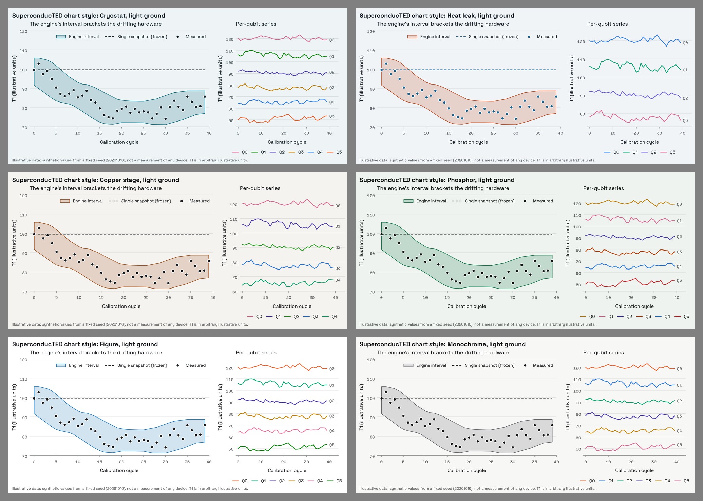

# SuperconducTED chart style

The look of every figure the team publishes. One matplotlib style per palette option, on a
light and a dark ground, plus a tiny helper so team code says *what* it draws (an interval, a
snapshot, a measurement) instead of picking colours.

> **Status, 2026-10-16:** the palette is not chosen yet (the owner picks after the team picks
> the mark), so all six options in `brand/tools/palettes.py` are generated and validated. Once
> one is picked, its file becomes `superconducted.mplstyle` and adoption in the engine is a
> follow-up pull request there.



*Every demo uses illustrative data from a fixed seed: no number on these figures is a
measurement of any device.*

## The three things we always draw

The story: Qiskit's `NoiseModel.from_backend` freezes one calibration of an IBM machine into
crisp numbers, but the hardware drifts between calibrations; the engine keeps every
calibration and answers with an interval that brackets the real hardware. So our figures keep
drawing the same three things, and they must look the same everywhere.

| Role | What it is | How it looks | Why |
| --- | --- | --- | --- |
| **Interval band** | The engine's answer, lower to upper bound | Solid accent tint, accent edges | The accent means **the range** and nothing else: the brand's one colour rule |
| **Crisp line** | The single-snapshot prediction, a frozen value | Ink, dashed, 1.5 pt | Ink is the machine. A dashed line reads as a frozen reference or projection, which is exactly what a snapshot is; nothing else in our charts is dashed |
| **Measured points** | What the hardware did (e.g. T1 per calibration cycle) | Ink dots, 6 pt, ringed in the ground colour | Ink is also the measurement. The ring keeps a dot legible where it sits on the band or the crisp line |

Per-qubit (or any per-entity) series take a **categorical sequence** that never contains the
accent's hue, so a series can never be mistaken for a range.

## Using it

### With the helper (recommended)

```python
import matplotlib.pyplot as plt
import superconducted_figures as scf       # brand/figures/ on sys.path, or copy the files

scf.use("cryostat")                        # any key of scf.PALETTES; dark=True for dark ground
fig, ax = plt.subplots()
scf.band(ax, cycles, lower, upper, label="Engine interval")
scf.crisp(ax, cycles, t1_snapshot, label="Single snapshot (frozen)")   # a scalar is fine
scf.measured(ax, cycles, t1, label="Measured")
ax.legend()

for q, c in zip(qubits, scf.series(len(qubits))):   # or just ax.plot: the style's cycle
    ax2.plot(cycles, t1_by_qubit[q], color=c, label=f"Q{q}")

scf.mono_ticks(fig)                        # Space Mono tick labels (tabular figures)
fig.savefig("t1.png")                      # 200 dpi, ground-coloured background
```

Contract: `use()` must run first (the drawing helpers raise `RuntimeError` otherwise). Each
helper returns the matplotlib artist, forwards extra keyword arguments, and refuses a colour
override for its role. `series(n)` raises when `n` exceeds the sequence: past that, use small
multiples or fold the rest into "other". The helper needs matplotlib 3.8 or later; it reads
`roles.json` and `styles/` next to itself and imports nothing else from the brand folder, so
the three can be copied into another repository as they are.

### With the style file only

```python
plt.style.use("brand/figures/styles/superconducted-cryostat.mplstyle")
```

This gives the ground, type, grid, axis and the categorical colour cycle (Space Grotesk tick
labels; `mono_ticks` is what switches them to Space Mono). The band, crisp and measured colours
are listed in the header comment of every style file and in `roles.json`: use those hex values
by role. The style files use rc keys that exist since matplotlib 3.5; they are tested on 3.11.2.

### From other tools

`roles.json` holds every named colour per palette and mode (`ground`, `text`,
`text_secondary`, `axis`, `grid`, `band_fill`, `band_edge`, `crisp`, `measured`,
`measured_ring`, `series`), with the gates and the reasons, for Plotly, Vega or TikZ.

## Fonts

Space Grotesk for text, Space Mono for tick labels and code-like labels. Both are SIL Open Font
License 1.1:

- **Space Grotesk:** `SpaceGrotesk-Regular.ttf`, `-Medium.ttf`, `-Bold.ttf` from `fonts/ttf/static`
  in https://github.com/floriankarsten/space-grotesk
- **Space Mono:** `SpaceMono-Regular.ttf`, `SpaceMono-Bold.ttf` from `ofl/spacemono` in
  https://github.com/google/fonts

Install them for your operating system (Windows: right-click, *Install for all users*; macOS:
Font Book; Linux: copy to `~/.local/share/fonts` and run `fc-cache -f`), then delete
matplotlib's font cache so it rescans: the `fontlist-*.json` file in the folder printed by
`python -c "import matplotlib; print(matplotlib.get_cachedir())"`. For one session without
installing, `matplotlib.font_manager.fontManager.addfont("<path to the ttf>")` works too.

**Without the fonts** the styles fall back, silently, to DejaVu Sans and DejaVu Sans Mono,
which ship with matplotlib. `check_styles.py` proves this in a fresh process that never sees
the brand fonts: no findfont or missing-glyph warning from any of the twelve styles. That is
also why titles use only Regular and Bold: DejaVu has no Medium, and asking for one logs a
warning on every machine without the brand fonts. Mathtext (`$T_1$`) keeps matplotlib's
DejaVu math font; plain text such as `T1` stays in the brand face.

## The band tint rule

The band is a **solid** colour, not an alpha, so it prints and overlaps the same everywhere:

    t = (1 - a) * ground + a * accent      (per sRGB channel, rounded to 8 bits)
    a = 0.20

`a` is measured, not picked (`build_styles.py` derives it and `roles.json` records it):

- **Floor 0.19** (light; 0.16 dark): the smallest coverage at which, in all six palettes, the
  fill differs from the ground by Delta E >= 8 (OKLab x 100, the dataviz method's target for
  telling two colours apart) under normal vision *and* simulated protanopia and deuteranopia.
  Below it, someone will not see the band as a region. Binding palette: Figure (light), Heat
  leak (dark).
- **Ceiling 0.23** (light; 0.44 dark): the largest coverage at which ink and text on the band
  keep 4.5:1 and the accent edge keeps 3:1 against its own fill. Binding palette: Heat leak,
  whose ice-blue ink is the lightest ink of the six.
- **0.20** is the floor rounded up to a memorable 0.05 step, one value for both modes. It stays
  a quiet wash (the dataviz method: never a saturated block). Measured at 0.20: ink on the band
  >= 4.72:1, accent edge on the band >= 3.65:1, text on the band >= 10.02:1.

The band's edges carry the bounds (they clear 3:1 on the ground, worst 4.82:1); the fill only
says "this is a region", so the fill itself is not held to 3:1. The edge is the band's whole
outline, so it also closes the band with a short vertical accent stroke at its first and last
x: deliberate, it reads as the brand's interval brackets `[ ]`. A band that spans the whole
x-range puts those strokes on the axis limits.

**Overlapping bands.** A later solid band paints over an earlier one, so the overlap shows one
fill and only the edges show both: predictable, but inside the overlap you cannot tell which
band is which. Put intervals that must be compared in small multiples, one band per axes.

## The categorical sequence

Derived per palette by `build_styles.py` from the dataviz skill's eight reference hues, with
the skill's own method (snap to passing, then enumerate orders):

1. A family within 30 degrees of the accent's OKLCH hue is out: that hue means "the range".
2. Each remaining family keeps its reference hue and moves only in lightness until it sits in
   the mode's lightness band, keeps chroma >= 0.10, clears **3:1 on the ground** (stricter than
   the skill, which allows lighter slots with labels), and stays apart from the accent and the
   ink as if they were neighbouring slots: Delta E >= 15 for normal vision and >= 8 under
   protanopia and deuteranopia (the band edge is a thin line, like a series line).
3. Every order of up to six families is tried; the kept order passes adjacent CVD Delta E >= 8
   and normal Delta E >= 15 in **both** modes, prefers orders whose first three slots are safe
   for every pair, then the largest worst adjacent CVD separation.

| Palette | Order | Light | Dark | All-pairs safe |
| --- | --- | --- | --- | --- |
| Cryostat | magenta, green, violet, yellow, blue, orange | `#D36992 #008300 #4A3AA7 #BD7F00 #2D7BD9 #E6632F` | `#D55181 #008300 #9085E9 #C98500 #3987E5 #D95926` | first 3 / 3 |
| Heat leak | blue, aqua, violet, magenta | `#317EDD #00A06E #6B61D1 #D56A93` | `#3987E5 #009366 #9085E9 #D55181` | first 2 / 2 |
| Copper stage | magenta, violet, green, blue, aqua | `#D56A93 #4A3AA7 #2C9A28 #2A78D6 #00A06E` | `#D55181 #9085E9 #008300 #3987E5 #009165` | first 4 / 3 |
| Phosphor | yellow, magenta, violet, orange, blue, red | `#BD7F00 #D36992 #4A3AA7 #B63F00 #2A78D6 #C62B30` | `#C98500 #D55181 #9085E9 #D95926 #3987E5 #E66767` | first 3 / 3 |
| Figure | orange, aqua, violet, yellow, magenta, green | `#EB6834 #08A974 #4A3AA7 #C78600 #DE729B #008300` | `#D95926 #199E70 #8377DA #C98500 #D55181 #008300` | first 3 / 3 |
| Monochrome | orange, blue, aqua, violet, yellow, magenta | `#E96632 #2A78D6 #00A26F #4A3AA7 #C18200 #D76C95` | `#D95926 #3987E5 #169C6F #877CDF #C98500 #D34F80` | first 4 / 3 |

Heat leak gets four slots and Copper five: their warm accent rules out orange, red and yellow,
and Heat leak's blue ink pushes the rest further. That is a real cost of those palettes for
per-qubit charts and is worth weighing when the palette is picked.

**"All-pairs safe"** is how many leading slots stay distinguishable *pairwise* (light / dark).
Lines and bars only need neighbours to differ (that is what the order guarantees); a scatter,
a bubble chart or overlaid points where any two series can touch should use no more series
than this number, then facet.

## Do and don't

**Do**

- Draw every engine interval with `band()`, every from_backend-style prediction with
  `crisp()`, every hardware value with `measured()`. Same meaning, same look, every figure.
- Give a chart with two or more roles or series a legend; direct end labels (in text colour,
  never in the series colour) may supplement it.
- Keep a qubit's colour the same across a set of figures: colour follows the entity, not its
  rank, so filtering out a qubit never repaints the others.
- Past the sequence length, use small multiples or an "other" group. Never invent a colour.
- Label illustrative or synthetic data as such on the figure.
- Save PNG for the web (200 dpi by default) and PDF or SVG for papers (TrueType embedded).

**Don't**

- Use the accent for anything but a range: no accent series, accent text or accent
  highlights.
- Fill bands with alpha, or stack two bands on one axes.
- Dash anything but the crisp line; gridlines and axes are solid hairlines.
- Put a second y-axis on a chart: two scales make a correlation up. Use two panels.
- Colour text with a series colour; text stays in the text colours.
- Use a series colour for good/bad status. No status colours are defined yet.
- Build a colormap from the accent hue (it means range). There is no brand colormap yet:
  use `viridis` or `cividis`.
- Edit `styles/` or `roles.json` by hand: change `palettes.py` or the generator and rerun.

## Files

| File | What it does |
| --- | --- |
| `build_styles.py` | Derives every role from `brand/tools/palettes.py`; writes `styles/` and `roles.json` (deterministic) |
| `colour_math.py` | OKLab / OKLCH, Machado 2009 colour-vision simulation, Delta E, sRGB tints; the dataviz thresholds |
| `superconducted_figures.py` | The team helper: `use`, `band`, `crisp`, `measured`, `series`, `mono_ticks`, `band_handle` |
| `build_demos.py` | Renders `demo/` (illustrative data, fixed seed); the only place that registers the brand fonts, from VectorCraft's folder |
| `check_styles.py` | The validation below; exits non-zero on any failure |
| `styles/superconducted-<key>[-dark].mplstyle` | Twelve styles: six palettes, light and dark ground |
| `roles.json` | Every named chart colour per palette and mode, with the gates and the reasons |
| `demo/` | `<key>.png`/`.svg`, `<key>-dark.png`/`.svg`, `all-palettes.png`, `all-palettes-dark.png` |

## Regenerate and validate

```
python -I brand/figures/build_styles.py --print
python -I brand/figures/build_demos.py
python -I brand/figures/check_styles.py [--skill-validator <validate_palette.py>] [--strict-demos]
```

`check_styles.py` recomputes every number from the hex values: roles agree with
`palettes.py` and the tint rule; text >= 4.5:1 and every line, point, band edge and series
colour >= 3:1 (WCAG 2.x, `brand/tools/wcag.py`); the categorical gates above; every style
loads with warnings as errors, including the unknown-key reports matplotlib sends to its
logger; the font fallback is silent; self-tests prove each guard can fail (an unknown key, a
bad value, a low-contrast colour, a colour-blind collision, a missing font); no en or em dash
in any text file here; the demos regenerate. Gridlines (1.27:1 to 1.43:1) are reported, not
gated: they are decoration, and the tick labels carry the values. With `--skill-validator`
each sequence also goes through the dataviz skill's own validator (adjacent pairs, and
all-pairs on the safe prefix). Byte identity of the demos needs the brand fonts and the same
matplotlib version, so it is reported, and only gated with `--strict-demos`.
