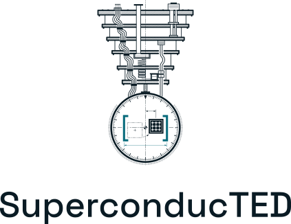

  <picture>
    <source media="(prefers-color-scheme: dark)" srcset="../brand/svg/superconducted-stacked-on-dark.svg">
    
  </picture>

<em>Noise as a range, not a number.</em>

Qiskit can describe an IBM quantum computer in one line by freezing its latest calibration. The
machine does not stay frozen: its noise is measured again many times a day, and it moves. We are
students at TED University in Ankara, building a noise engine for Qiskit Aer that learns from the
whole calibration record and aims to answer with the range the hardware moves through, not one
crisp number.

## Projects

| Project | What it is |
|---|---|
| [**superconducted-noise-engine**](https://github.com/SuperconducTED/superconducted-noise-engine) | A fuzzy-logic noise engine for Qiskit Aer: it turns IBM calibration snapshots into an ensemble of noise models, aiming for interval predictions that track real hardware across calibration cycles. Research preview. |
| [**superconducted.github.io**](https://superconducted.github.io/) | The website: the idea, the method and its equations, and the team, in English and Turkish. |
| **superconducted-codesign** | The requirements and design record for the SuperconducTED co-design tool. Private for now. |

## How we work

- Decisions are written down in an architecture decision record before they are built on.
- Every number we publish traces to a numerical-claims register, with its source and the date it
  was measured.
- Aims are stated as aims: until a result is measured, we say what we are building, not what it
  achieves.
- Every change ships with a record of what was done, why, and how it was checked.

[Website](https://superconducted.github.io/) · [Logo and brand guide](../brand/README.md) · [Code of conduct](../CODE_OF_CONDUCT.md) · [Contributing](../CONTRIBUTING.md)
